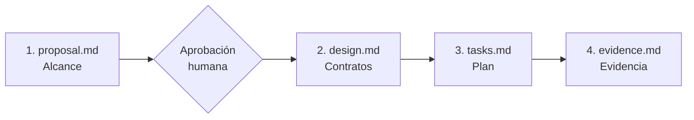

# Plantilla de cambios atómicos y especificaciones vivas

Plantilla para documentar un cambio incremental (nueva funcionalidad, refactorización o ajuste de contrato) **antes** de tocar código, y dejar la evidencia de que funciona **después**. Se inspira en la práctica de *spec-driven development* (desarrollo guiado por especificaciones) y en herramientas como OpenSpec; aquí se adapta al stack del SDD.

Protocolo que la rige: [`greenfield/14_protocolo_cambios_atomicos_y_especificaciones_vivas.md`](../greenfield/14_protocolo_cambios_atomicos_y_especificaciones_vivas.md).

---

## ¿Cuándo usarla?

| Nivel (ver [`SPEC_GUIDE.md` §1.0](../greenfield/SPEC_GUIDE.md)) | Ejemplo | ¿Usa esta plantilla? |
|---|---|---|
| 1. Ajuste menor / corrección puntual | Texto, color, bug trivial sin cambio de contrato | No. Basta el mensaje de commit y la prueba que cubra el arreglo. |
| 2. Cambio atómico | Nuevo endpoint, nuevo drawer en una vista existente, refactor de un módulo | **Sí (DEBERÍA).** |
| 3. Módulo o proyecto nuevo | Pantalla o sistema desde cero | Sí, más el flujo completo de `SPEC_GUIDE.md`. |

**Por qué:** un cambio con alcance escrito y criterios de aceptación reduce el trabajo fuera de alcance (propio o de un agente de IA) y deja un registro revisable de qué se decidió y cómo se verificó. El costo es tiempo de redacción, por eso no se exige en el nivel 1.

---

## Estructura

```text
<proyecto>/
└── specs/
    └── changes/
        └── AAAA-MM-DD-nombre-del-cambio/
            ├── proposal.md   # 1. Problema, alcance y lo que NO incluye
            ├── design.md     # 2. Contratos, componentes, impacto en BD y casos de borde
            ├── tasks.md      # 3. Tareas pequeñas y verificables, con casillas [ ]
            └── evidence.md   # 4. Salida real de las herramientas de verificación
```

## Ciclo



1. **Propuesta**: problema, valor esperado y límites de alcance. Una persona la aprueba antes de seguir.
2. **Diseño**: contratos de datos, endpoints (registro en `backend/config/endpoints_registry.json`), componentes de `.sdd/components/` que se reutilizan y casos de borde.
3. **Tareas**: se ejecutan en orden; si una falla, se detiene y se reporta.
4. **Evidencia**: el cambio NO DEBE declararse terminado sin pegar la salida real de las verificaciones (pruebas, lint, validador de endpoints). Lo que no se pudo ejecutar se declara como "no ejecutado" con el motivo.

## Cómo iniciar un cambio

```bash
# Linux / macOS / Git Bash
cp -r .sdd/changes_template specs/changes/2026-10-15-filtro-avanzado-pedidos
rm specs/changes/2026-10-15-filtro-avanzado-pedidos/README.md
```

```powershell
# Windows PowerShell
Copy-Item -Recurse .sdd\changes_template specs\changes\2026-10-15-filtro-avanzado-pedidos
Remove-Item specs\changes\2026-10-15-filtro-avanzado-pedidos\README.md
```

La carpeta `specs/changes/` se versiona en Git junto con el código.
