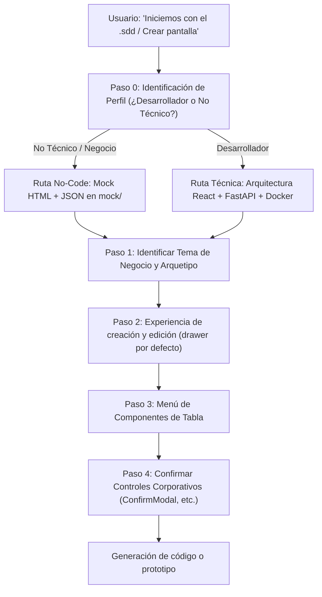

# Guía del Asistente Interactivo de Diseño de Páginas y Vistas
## Ecosistema Jolifoods — Metodología Spec-Driven Development (SDD)

Esta guía define el protocolo de conversación y asesoría arquitectónica que la **Inteligencia Artificial** o el **líder técnico** debe seguir cuando alguien solicita: *"vamos a crear una página"*, *"quiero un CRUD"*, *"diseñemos una pantalla de pedidos"* o *"necesito una tabla"*.

---

## 1. Regla de Oro: Asesorar Antes de Codificar

> **PRINCIPIO ARQUITECTÓNICO**:
> La Inteligencia Artificial **NO DEBE GENERAR CÓDIGO INMEDIATAMENTE**.
> Primero debe guiar a la persona a través de decisiones de experiencia de usuario (UX), ofreciendo recomendaciones técnicas fundamentadas y listas interactivas de componentes para que el usuario elija con facilidad.

---

## 2. Flujo de Diálogo Interactivo en 5 Pasos



---

### Paso 0: Identificación Inicial de Perfil (Mandatorio)

> **REGLA OBLIGATORIA**:
> La IA **NUNCA DEBE ASUMIR UN TEMA O DOMINIO POR DEFECTO** (ej. clima, ventas, pedidos) ni asumir el perfil técnico de la persona.
> Lo primero que debe consultar es el rol y el tema:

> *"¡Hola! Antes de iniciar, para adaptar las opciones y entregables a tu perfil:*
> *1. **¿Eres desarrollador de software o tienes un perfil no técnico / de negocio?***
>    - **Perfil No Técnico / Negocio**: Generamos prototipos visuales interactivos autónomos (HTML + Array JSON + .md de datos) listos para abrir con doble clic y entregar al equipo de desarrollo.
>    - **Perfil Desarrollador / Técnico**: Diseñamos contratos de API, esquemas Pydantic/DRF, componentes React 19 y arquitectura técnica de producción.
> *2. **¿Qué módulo o temática de negocio deseas construir?** (Ej. Ventas, Inventario, Clima, Cartera, Producción, etc.)"*

---

### Paso 1: Identificar el Arquetipo de Página
Una vez confirmado el perfil y el tema, la IA presenta las 4 opciones de diseño:

> *"Para estructurar tu módulo, ¿qué tipo de pantalla deseas construir?"*

- **[A] Gestión de Entidad / CRUD Operativo (Recomendado)**: Listado con tabla, filtros tipo Excel, buscador en vivo y opciones para crear, editar, inspeccionar y dar de baja registros.
- **[B] Tablero de Control / Dashboard**: Métricas KPI superiores clickeables, gráficos interactivos, telemetría y bitácora de actividad reciente.
- **[C] Consulta Tabular / Reporte Analítico**: Tabla masiva con exportación a Excel, ordenamiento avanzado y filtros de auditoría.
- **[D] Asistente por Pasos (Wizard)**: Formulario secuencial (Paso 1, 2, 3) para procesos con muchas etapas.


---

### Paso 2: Experiencia de creación y edición

Convención del SDD (DEBERÍA): **crear y editar registros en el panel lateral derecho (drawer)**. **Por qué:** el usuario conserva a la vista la tabla de la que viene, puede consultar otros registros y el patrón es el mismo en todas las aplicaciones. La IA informa esta opción como predeterminada y solo ofrece las alternativas si el usuario las pide o el caso lo justifica (quedando registrado en el `design.md` del cambio o en un ADR):

```text
----------------------------------------------------------------------------------------------------
           EXPERIENCIA PARA FORMULARIOS DE CAPTURA / EDICIÓN
----------------------------------------------------------------------------------------------------
 (1) [Predeterminado] Panel lateral derecho (Drawer)
     -> Tamaños: sm 400px (detalle breve), md 600px (formulario estándar), lg 840px (formularios
        extensos o pestañas). Cabecera fija, cuerpo con scroll propio, pie con Guardar / Cancelar.
     -> Ref: .sdd/components/drawer/drawer.md

 (2) [Excepción, solo a pedido] Modal centrado (ModalDialog)
     -> Para un dato puntual (p. ej. un motivo o una fecha) que no justifica abrir un panel.
        Confirmaciones críticas usan ConfirmModal, no formularios.
     -> Ref: .sdd/components/modal/modal_dialog.md

 (3) [Excepción, solo a pedido] Página dedicada (/nuevo y /editar/:id)
     -> Entidades muy extensas con varias pestañas y anexos, donde el contexto de la tabla no aporta.
----------------------------------------------------------------------------------------------------
```

---

### Paso 3: Configurar los Componentes de la Tabla de Datos

Si la página incluye una tabla, la IA presenta el **Menú de Capacidades de Tabla** mostrando la lista preseleccionada:

> *"Para la tabla de datos, he preseleccionado el estándar empresarial Jolifoods. ¿Deseas activar todas estas capacidades o ajustar la selección?"*

```text
====================================================================================================
               COMPONENTES ACTIVABLES PARA LA TABLA DE DATOS (DATA TABLE)
====================================================================================================
 [x] (1) Filtros de Columna Tipo Excel (ChecklistPopover en cada <th>)
         -> Menú emergente con orden A-Z/Z-A, buscador interactivo, casillas con conteo (N) y botón 'Solo'.
 [x] (2) Paginador Superior Integrado en Toolbar (Pagination)
         -> Ubicado ARRIBA de la tabla en toolbar superior, con resumen 'Mostrando X a Y de Z', elipsis de páginas y selector de filas (10, 20, 50, 100).
 [x] (3) Exportador Limpio a Excel (ExportExcelButton)
         -> Genera .xlsx con anchos auto-ajustados respetando estrictamente los filtros aplicados.
 [x] (4) Selector de Columnas Visibles (Columns3 Toggle)
         -> Menú desplegable para ocultar o mostrar columnas con persistencia en el navegador.
 [x] (5) Buscador Reactivo General
         -> Búsqueda en tiempo real con debounce y botón 'X' para limpiar.
 [x] (6) Botón 'Restablecer Filtros' (FilterX)
         -> Aparece automáticamente cuando hay filtros activos con contador (N) para limpiar en un clic.
 [x] (7) Cabeceras Fijas (Sticky Headers)
         -> Encabezados sticky que no se pierden al desplazarse verticalmente.
 [x] (8) Tarjetas de Resumen KPI Superiores 
         -> 3 a 5 tarjetas superiores que actúan como filtros cruzados rápidos al hacer clic sobre ellas.
====================================================================================================
```

---

### Paso 4: Confirmar la Normativa de Controles Internos y Layout

La IA informa las convenciones que aplicará (DEBERÍA; se pueden ajustar si el usuario lo pide o con un ADR):
1. **Layout Full-Width por Defecto (Cero Sidebar)**: Toda pantalla es de ancho completo a menos que el usuario pida explícitamente navegación lateral. El título de pantalla/módulo va en el **TopHeader a la izquierda (`.topheader-left`)** junto a la marca, marcado como el `<h1>` de la página (único encabezado principal, sin repetir un título grande en el cuerpo).
2. **Paginación Superior y Card hasta Abajo (Estándar SDD)**: El paginador se ubica **ARRIBA DE LA TABLA** en la toolbar superior (`.table-header-toolbar.pagination-container`), y la card contenedora (`.main-card-container`) tiene `flex: 1` ocupando todo el espacio vertical disponible hasta el fondo del viewport visible.
3. **Estilo Corporativo en Controles de Formulario e Inputs**: Todo `<input>`, `<select>` y `<textarea>` dentro de modales o del Right Drawer debe implementar `.form-field` / `.drawer-form-field`, etiquetas en mayúsculas discretas (`.form-label`) y contenedor `.input-control` / `.drawer-input-control` con bordes, radios y halo de foco de acento corporativo (no inputs nativos sin estilo).
4. **Textos Contextuales en Botones**: El botón principal del footer en formularios debe reflejar la entidad (ej. *"Guardar Registro"*), evitando textos genéricos o que no correspondan a la entidad.
5. **Acciones agrupadas**:
   - En Toolbar: Caja compacta de 28px (`.compact-action-box`) con iconos `+`, `FileSpreadsheet` verde y `RefreshCw`.
   - En Filas de Tabla: Grupo Bootstrap `btn-group btn-group-sm row-actions-group` de 26px con `role="group"`; botones solo-icono con `aria-label` (no botones sueltos).
6. **Cero Texto Verde o Azul en Códigos/IDs**: Los identificadores y números usan fuente monoespaciada con color de texto neutro. El verde se reserva para estados positivos.
7. **Cero Selects Planos**: Todos los catálogos o claves foráneas utilizarán `SelectFilter` (Searchable Select interactivo con soporte de teclado).
8. **Cero Confirmaciones Nativas**: Suspensiones, bajas o reinicios de clave utilizarán el `ConfirmModal` con justificación de 10+ caracteres, portal y spinner.
9. **Cero Alertas Bloqueantes**: Mensajes de éxito o fallos de red se notificarán mediante `ToastNotification`.
10. **Respaldo ante Pantalla Vacía**: Si no hay datos o los filtros no coinciden, se desplegará el componente `EmptyState`.
11. **Paquete Modular No-Code en 4 Archivos**: Para prototipos en `mock/<modulo>/`, la entrega DEBERÍA dividirse en 4 archivos independientes (`.html`, `.css`, `.js`, `datos_*.md`), en lugar de un único archivo.

---

## 3. Ejemplo Práctico de Diálogo Real

### Escenario: Usuario solicita crear un CRUD de Proveedores

**Usuario**:
> *"Vamos a crear una página para la gestión de proveedores con una tabla"*

**Respuesta sugerida del asistente**:
> *"¡Con gusto! Para estructurar la página de **Gestión de Proveedores** con las convenciones del SDD, definamos la experiencia de usuario:
>
> 1. **Layout y Encabezado**:
>    - Full-Width (sin sidebar) con título 'Gestión de Proveedores' integrado en el TopHeader a la izquierda (`.topheader-left`) junto al logotipo.
>
> 2. **Formulario de Creación / Edición**:
>    - Se abrirá en el **panel lateral derecho (drawer)**, para editar sin perder de vista la tabla. Si prefieres otra experiencia, dímelo.
>
> 3. **Componentes para la Tabla de Proveedores**:
>    He preparado la configuración recomendada:
>    - [x] Toolbar compacta con acciones agrupadas en 28px (`+`, Excel verde, Refrescar)
>    - [x] Acciones por fila agrupadas en contenedor unificado de 26px (`btn-group btn-group-sm`)
>    - [x] Códigos y NITs en tipografía monoespaciada neutra (sin textos verdes)
>    - [x] Filtros por columna tipo Excel (`ChecklistPopover` en NIT, Ciudad, Estado)
>    - [x] Selector de columnas visibles (`Columns3`)
>    - [x] Paginador arriba de la tabla, paginación en servidor (`Pagination` 10, 25, 50, 100)
>    - [x] 3 KPIs superiores (Total Proveedores, Activos, Bloqueados) como filtros rápidos
>    - [x] Diálogo corporativo (`ConfirmModal`) con justificación obligatoria para dar de baja proveedores
>
> ¿Te parece bien esta arquitectura o deseas modificar algún elemento antes de generar la especificación?"*
