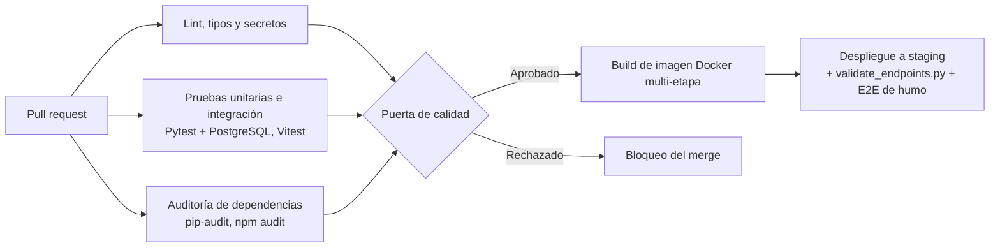

# Protocolo 06: control de versiones, CI/CD y puertas de calidad

Reglas para el control de versiones, las verificaciones antes de cada commit, la detección de secretos y la integración y despliegue continuos (**CI/CD**: ejecutar automáticamente lint, pruebas y empaquetado en cada cambio).

Las palabras **DEBE / NO DEBE / DEBERÍA / PUEDE** siguen la RFC 2119. Las buenas prácticas BP-xx se definen en [`00_normativa_buenas_practicas_y_auditoria.md`](./00_normativa_buenas_practicas_y_auditoria.md).

> **Estado de implementación en el SDD**: el SDD **no incluye todavía** un `.pre-commit-config.yaml` ni un flujo de CI listo para usar en `stack/`. Este protocolo describe la configuración de referencia que cada proyecto DEBE crear; lo que sí genera el andamiaje (`stack/init_project.py`) es `pytest.ini` y `backend/requirements-dev.txt`.

---

## 1. Herramientas por capa (decisión del SDD)

| Capa | Herramienta | Dónde / cómo |
|---|---|---|
| Pruebas backend | **Pytest** (+ pytest-django) contra **PostgreSQL** | `pruebas/` en la raíz; `pytest.ini` con `testpaths = pruebas`. |
| Pruebas frontend | **Vitest** (+ Testing Library) | Archivos `*.test.tsx` junto al componente; `npm test`. |
| Extremo a extremo (E2E) | **pytest-playwright** | `pruebas/e2e/`, marca `e2e` (`pytest -m e2e`). |
| Humo HTTP | `pruebas/validate_endpoints.py` (copia de `.sdd/stack/validate_endpoints.py`) | Contra un servidor levantado; contraseña en `SDD_LOGIN_PASSWORD`. |
| Lint y formato Python | **Ruff** (`ruff check`, `ruff format`) | Reemplaza a flake8, isort y Black. |
| Lint frontend | **ESLint** con `typescript-eslint` | `npm run lint`. |
| Tipos TypeScript | `tsc --noEmit` con `"strict": true` | `strict` activa `noImplicitAny`. |
| Dependencias vulnerables | **pip-audit** y **npm audit --audit-level=high** | En CI. |
| Secretos en el código | **detect-secrets** (o gitleaks) | En pre-commit y CI. |

Las dependencias de prueba y calidad de Python van en `backend/requirements-dev.txt` (no en `requirements.txt`, que es lo que se instala en producción). Guía detallada de pruebas: [`../stack/e2e_testing_guide.md`](../stack/e2e_testing_guide.md) y protocolo 11.

**Por qué PostgreSQL y no SQLite en pruebas:** SQLite difiere en tipos, bloqueos, `JSONField` y restricciones; probar contra el mismo motor de producción evita falsos positivos.

---

## 2. Ganchos pre-commit (verificación local antes de cada commit)

Cada proyecto DEBERÍA configurar [pre-commit](https://pre-commit.com/) para que los errores evidentes no lleguen al repositorio. **Por qué:** es la verificación más barata; corrige formato y detecta secretos antes de que queden en el historial de Git (de donde son difíciles de borrar).

Configuración de referencia `.pre-commit-config.yaml` (fijar versiones y actualizarlas con `pre-commit autoupdate`):

```yaml
repos:
  - repo: https://github.com/astral-sh/ruff-pre-commit
    rev: v0.6.9
    hooks:
      - id: ruff
        args: [--fix]
      - id: ruff-format

  - repo: https://github.com/pre-commit/pre-commit-hooks
    rev: v4.6.0
    hooks:
      - id: check-yaml
      - id: check-json
      - id: end-of-file-fixer
      - id: trailing-whitespace
      - id: check-added-large-files
        args: ['--maxkb=2048']
      - id: detect-private-key

  - repo: https://github.com/Yelp/detect-secrets
    rev: v1.5.0
    hooks:
      - id: detect-secrets
        args: ['--baseline', '.secrets.baseline']

  - repo: local
    hooks:
      - id: eslint
        name: eslint (frontend)
        entry: npm --prefix frontend run lint
        language: system
        files: ^frontend/.*\.(ts|tsx)$
        pass_filenames: false
```

Instalación (dentro del `.venv`, nunca en el Python global). `pre-commit` y `detect-secrets` no vienen en el `requirements-dev.txt` de la plantilla: agregarlos al del proyecto si se adopta este paso.

```powershell
.\.venv\Scripts\python.exe -m pip install -r backend\requirements-dev.txt pre-commit detect-secrets
.\.venv\Scripts\pre-commit.exe install
.\.venv\Scripts\detect-secrets.exe scan > .secrets.baseline
```

Configuración de Ruff sugerida en `pyproject.toml`: `line-length = 100` y reglas `E`, `F`, `I`, `B`, `S` (la familia `S` cubre chequeos de seguridad equivalentes a Bandit).

---

## 3. Ramas

Modelo de referencia (DEBERÍA; un equipo pequeño PUEDE usar *trunk-based development* — una sola rama principal con ramas cortas — registrándolo en un ADR):

1. **`main`** (producción): solo recibe código por *pull request* aprobado. Protección de rama en el servidor Git: al menos 1 aprobación, CI en verde y `push --force` bloqueado.
2. **`develop`** (integración / staging): recibe las funcionalidades terminadas.
3. **`feature/<nombre-en-kebab-case>`**: nacen de `develop` (p. ej. `feature/filtro-pedidos`).
4. **`hotfix/<id-incidente>`**: nacen de `main` y se fusionan en `main` y luego en `develop`.

**Por qué:** separar lo que está en producción de lo que está en integración permite corregir urgencias sin arrastrar trabajo a medio terminar.

---

## 4. Mensajes de commit y versionado

### Conventional Commits
Los mensajes DEBERÍAN seguir [Conventional Commits 1.0.0](https://www.conventionalcommits.org/es/v1.0.0/): `tipo(ámbito): descripción`.

| Tipo | Uso |
|---|---|
| `feat` | Funcionalidad nueva. |
| `fix` | Corrección de un error (incluidas correcciones de seguridad: `fix(auth): ...`). |
| `perf` | Mejora de rendimiento. |
| `refactor` | Cambio interno sin alterar el comportamiento. |
| `test` | Pruebas nuevas o ajustadas. |
| `docs`, `build`, `ci`, `chore`, `style`, `revert` | Documentación, empaquetado, CI, mantenimiento, formato, reversión. |

Un cambio que rompe compatibilidad se marca con `!` (`feat(api)!: ...`) o con el pie `BREAKING CHANGE: <descripción>`.

**Por qué:** permite generar el historial de cambios y deducir la versión siguiente de forma automática.

### Versionado semántico (SemVer 2.0.0, `MAJOR.MINOR.PATCH`)
* **MAJOR**: cambios incompatibles con versiones anteriores (API pública, contrato de datos).
* **MINOR**: funcionalidad nueva compatible.
* **PATCH**: correcciones compatibles (incluidos parches de seguridad que no rompen compatibilidad).

La versión de la aplicación (SemVer) es distinta de la versión mayor en la URL de la API (`/api/v1/`), que solo cambia ante rupturas del contrato HTTP (protocolo 09).

---

## 5. Puertas de calidad en CI

El flujo de CI (GitHub Actions, GitLab CI u otro) DEBE ejecutar en cada *pull request*:



Comandos de referencia:

```bash
ruff check . && ruff format --check .
npm --prefix frontend run lint && npx --prefix frontend tsc --noEmit
python -m pytest -m "not e2e" --cov=backend --cov-report=term-missing   # pytest.ini: testpaths = pruebas
npm --prefix frontend test -- --run
pip-audit -r backend/requirements.txt
npm --prefix frontend audit --audit-level=high
python pruebas/validate_endpoints.py --base-url "$STAGING_URL"   # tras desplegar en staging
python -m pytest -m e2e pruebas/e2e                               # humo E2E contra staging
```

### Criterios de rechazo
| Criterio | Nivel | Por qué |
|---|---|---|
| Lint, tipos o pruebas con fallos | DEBE bloquear | Un fallo conocido no debe llegar a producción. |
| Secreto detectado | DEBE bloquear | Un secreto en Git se considera filtrado y hay que rotarlo. |
| Vulnerabilidad alta o crítica en dependencias (`pip-audit`, `npm audit --audit-level=high`) sin excepción documentada | DEBE bloquear | Son fallos conocidos y públicos. Excepción: sin parche disponible, se documenta el riesgo con fecha de revisión. |
| Cobertura de la capa de servicios/negocio por debajo de 80 % | DEBERÍA bloquear | Indicador de riesgo, no de calidad por sí mismo; el umbral PUEDE ajustarse por proyecto con un ADR. |
| Fallo en `validate_endpoints.py` o en una prueba E2E de humo en staging | DEBE bloquear el paso a producción | Indica que el despliegue no funciona aunque las pruebas unitarias pasen. |

> Nota terminológica: `pip-audit` y `npm audit` son análisis de composición de software (**SCA**: buscan vulnerabilidades conocidas en dependencias). El análisis estático de seguridad del código propio (**SAST**) lo cubren las reglas `S` de Ruff o herramientas como Semgrep.
