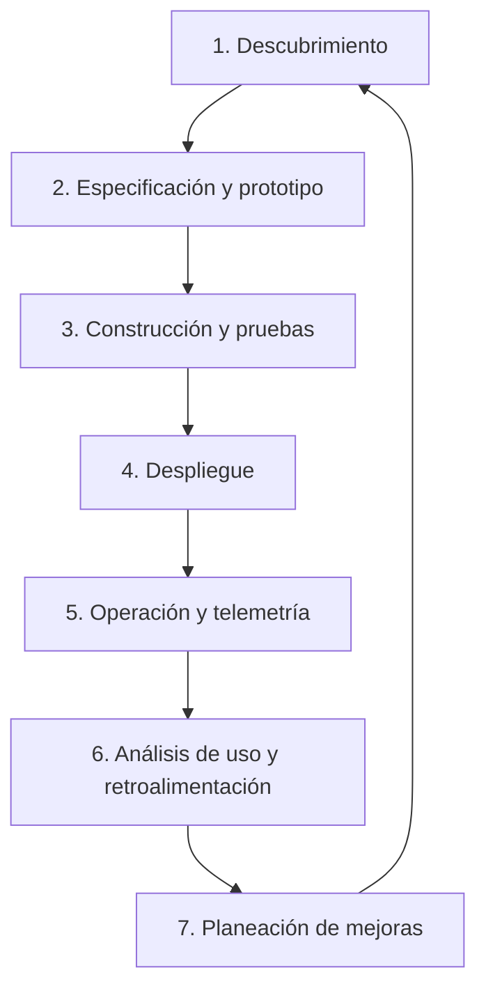

# Protocolo 12: ciclo de vida del software y mejora continua

Fases del ciclo de vida de una aplicación (SDLC, *Software Development Life Cycle*) y cómo usar datos de uso real para decidir qué mejorar.

Las palabras **DEBE / DEBERÍA / PUEDE** siguen la RFC 2119.

> **Estado de implementación**: normativo. El componente [`platform_usage_dashboard.md`](../components/dashboard/platform_usage_dashboard.md) y el modelo [`model/telemetria/`](../model/telemetria/spec_model_telemetria.md) especifican la telemetría de uso; no hay instrumentación lista en `stack/`.

---

## 1. Principio: una aplicación no termina en el primer despliegue

Una aplicación en producción DEBERÍA revisarse periódicamente con datos de uso, porque las necesidades del negocio cambian y el uso real suele diferir de lo que se supuso al diseñarla.



---

## 2. Fases

| Fase | Objetivo | Entregables / controles | Referencia |
|---|---|---|---|
| 1. Descubrimiento | Entender el problema operativo sin presuponer la solución. Identificar a todas las áreas afectadas, no solo a quien pide. | Preguntas del paso 0, problema y valor esperado, áreas impactadas. | `SPEC_GUIDE.md` §1.1 |
| 2. Especificación y prototipo | Contratos de datos, modelos y prototipo navegable. | Aprobación de pantallas por usuarios operativos antes de programar el backend. | Protocolo 05, `mock/` |
| 3. Construcción y pruebas | Implementar con el stack del SDD. | BP-01 a BP-25 (normativa 00); pruebas del protocolo 11; validador de endpoints. | Protocolos 00, 11, 14 |
| 4. Despliegue | Poner en producción con riesgo controlado. | Imágenes Docker multi-etapa, migraciones del protocolo 08, puertas de calidad del 06. Liberación gradual (*canary* o *blue/green*) PUEDE usarse si la infraestructura lo permite. | Protocolos 06, 08 |
| 5. Operación | Medir estabilidad. | Sondas de salud, identificador de correlación, SLO. | Protocolo 07 |
| 6. Análisis de uso | Saber qué módulos se usan, cuáles se abandonan y qué confunde. | Telemetría de eventos y micro-encuestas. | §4 |
| 7. Planeación de mejoras | Convertir datos en backlog priorizado. | Priorización RICE. | §5 |

---

## 3. Roles

| Tema | Perfil técnico (desarrollo) | Perfil sénior (líder técnico / arquitectura) |
| :--- | :--- | :--- |
| Monitoreo | Revisa errores 4xx/5xx y endpoints lentos. | Analiza adopción (DAU/MAU: usuarios activos diarios / mensuales) y abandono por módulo. |
| Retroalimentación | Clasifica sugerencias y corrige fricciones reportadas. | Define las preguntas de las encuestas y el plan de mejoras. |
| Mejoras | Optimiza consultas (`select_related`), componentes y rendimiento. | Evalúa costo/beneficio, deuda técnica y coordina con las áreas de negocio. |
| Gobierno del SDD | Usa componentes y protocolos existentes. | Revisa la adopción y propone cambios al SDD con evidencia. |

---

## 4. Telemetría de uso y micro-encuestas

La telemetría de uso y las encuestas tratan datos de personas; por eso:
* DEBEN informarse al usuario (aviso de privacidad) y limitarse a la finalidad de mejorar la aplicación (Ley 1581 de 2012).
* DEBERÍAN analizarse de forma agregada; el identificador del usuario se guarda seudonimizado (p. ej. hash con sal) salvo que se necesite contactar a la persona y ella lo acepte.
* La encuesta DEBE ser opcional y descartable.

Contrato de referencia de una respuesta de encuesta:

```typescript
export interface UserFeedbackSurvey {
  respondentId: string;          // identificador seudonimizado, no el documento ni el correo
  userRole: string;              // rol o perfil, para analizar por tipo de usuario
  module: string;                // módulo desde donde se respondió
  mostUsedFeature: string;       // ej. "Filtros tipo Excel en la tabla de pedidos"
  leastUsedFeature?: string;     // ej. "Visor PDF"
  painPoints: string;            // ej. "La carga de evidencias tarda en redes móviles lentas"
  suggestedImprovement: string;  // ej. "Comprimir fotos antes de subirlas"
  satisfactionScore: 1 | 2 | 3 | 4 | 5;
  submittedAtIso: string;        // ISO 8601 en UTC
}
```

Preguntas sugeridas: "¿Qué función usas más en tu jornada?", "¿Qué proceso te toma demasiado tiempo o te confunde?", "¿Qué necesitarías para trabajar más rápido?".

---

## 5. Priorización RICE

Para ordenar el backlog de mejoras se PUEDE usar RICE (método de Intercom):

$$\text{Puntaje} = \frac{\text{Alcance} \times \text{Impacto} \times \text{Confianza}}{\text{Esfuerzo}}$$

* **Alcance** (*Reach*): usuarios o transacciones afectadas por periodo.
* **Impacto**: escala acordada (p. ej. 0,25 – 3).
* **Confianza**: qué tan seguros estamos de las estimaciones (%).
* **Esfuerzo**: persona-semanas.

RICE ordena, no decide: las mejoras que afectan a varias áreas o tienen riesgo regulatorio se discuten con esas áreas aunque su puntaje sea bajo.

---

## 6. Cadencia sugerida

1. **Revisión mensual** de métricas de uso y errores.
2. **Funcionalidades poco usadas**: lo que tenga uso muy bajo (referencia: < 2 % de los usuarios activos en 90 días) DEBERÍA revisarse para simplificar, rediseñar o retirar. Antes de retirar, confirmar con el área dueña: una función poco usada puede ser crítica (p. ej. un cierre anual).
3. **Capacidad para mejoras**: reservar una parte de cada ciclo (p. ej. 1 de cada 4 sprints o un porcentaje fijo) para usabilidad, rendimiento y deuda técnica.
