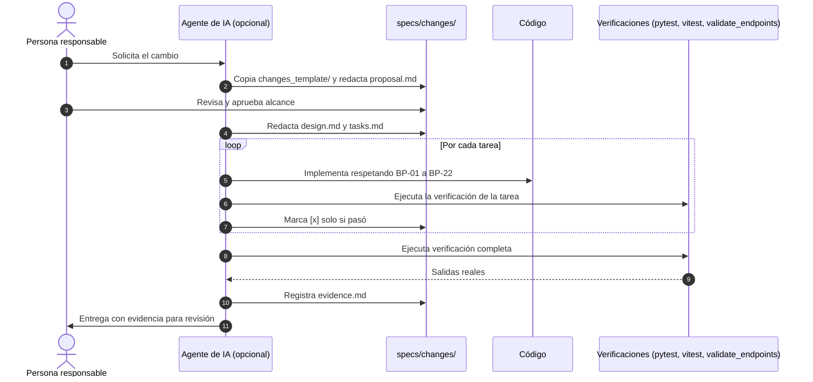

# Protocolo 14: cambios atómicos y especificaciones vivas

Cómo planear, ejecutar y verificar un cambio incremental (funcionalidad nueva, refactorización, ajuste de contrato) en un proyecto existente, de forma que el alcance quede acotado y la verificación quede demostrada.

Se inspira en el desarrollo guiado por especificaciones (*spec-driven development*) y en herramientas como OpenSpec. Plantilla: [`../changes_template/`](../changes_template/README.md).

Las palabras **DEBE / DEBERÍA / PUEDE** siguen la RFC 2119.

---

## 1. Problema que resuelve

Cuando se piden cambios sin un acuerdo previo de alcance (a una persona o a un agente de IA) es frecuente que:
1. **El alcance crezca solo**: se modifican archivos no relacionados, se agregan librerías no aprobadas o se reescriben estilos existentes.
2. **Se rompan contratos**: sin una lista de verificación, se omiten casos de borde o se cambia la forma de una respuesta que otro consumidor usa.
3. **Se declare terminado sin verificar**: "ya funciona" sin haber ejecutado pruebas.

---

## 2. Regla

Un cambio de **nivel 2** (ver `SPEC_GUIDE.md` §1.0) DEBERÍA tener, antes de modificar código, una carpeta aprobada `specs/changes/AAAA-MM-DD-nombre-cambio/` con:
1. `proposal.md` — problema, alcance, fuera de alcance, impacto en otras áreas y criterios de aceptación.
2. `design.md` — contratos, componentes, impacto en base de datos, casos de borde y reversión.
3. `tasks.md` — tareas pequeñas y verificables.
4. `evidence.md` — salida real de las verificaciones.

Los cambios de nivel 1 (ajustes menores) no la requieren. **Por qué DEBERÍA y no DEBE:** el valor de la plantilla depende del tamaño del cambio; para un equipo pequeño, exigirla siempre generaría documentos vacíos. Lo que sí DEBE cumplirse siempre es que un cambio no se declare terminado sin evidencia de las verificaciones (§3.D).

---

## 3. Contenido de cada artefacto

### A. `proposal.md`
* **Problema y motivación**, distinguiendo hechos de supuestos.
* **Alcance**: qué se construye.
* **Fuera de alcance**: lo que NO DEBE tocarse en este cambio.
* **Impacto en otras áreas o sistemas** (otras unidades de negocio, reportes, integraciones).
* **Criterios de aceptación** verificables.
* Una persona aprueba la propuesta antes de pasar al diseño.

### B. `design.md`
* Componentes de `.sdd/components/` reutilizados.
* Contratos de endpoints (entrada, salida, registro en `backend/config/endpoints_registry.json`) y si el cambio rompe compatibilidad (protocolo 09).
* Impacto en base de datos: transacciones (BP-12), escritura en bloque (BP-13), *Expand & Contract* si hay migración en producción (protocolo 08).
* Casos de borde: 401/403, 409, datos inválidos, lista vacía, red caída.
* Cómo se revierte.

### C. `tasks.md`
* Tareas pequeñas, cada una con su verificación.
* Se ejecutan en orden; si una falla, se detiene y se reporta.

### D. `evidence.md`
Salida real (no resumida ni inventada) de:
1. Pruebas de backend: `.\.venv\Scripts\python.exe -m pytest -m "not e2e"`.
2. Pruebas de frontend: `npm test`.
3. Prueba de humo HTTP: `.\.venv\Scripts\python.exe pruebas\validate_endpoints.py --base-url http://localhost:8000` (código de salida 0; contraseña en `SDD_LOGIN_PASSWORD`).
4. Lint (`ruff check .`, `npm run lint`) y, si cambian dependencias, `pip-audit` / `npm audit --audit-level=high`.
5. Revisión de la lista de verificación de la normativa 00 (BP-01 a BP-22) que aplique al cambio.

Lo que no se ejecutó se marca **NO EJECUTADO** con el motivo.

> **Estado de implementación**: la plantilla existe; el SDD no verifica automáticamente que un *pull request* traiga su carpeta de cambio. Esa verificación queda a la revisión de código (o a un chequeo de CI que cada proyecto PUEDE agregar).

---

## 4. Flujo

---

## 5. Especificaciones vivas

Cuando un requisito cambia durante o después de la implementación:
1. Se actualiza primero la especificación (`proposal.md` o `design.md`), dejando constancia del cambio.
2. Luego se modifica el código.
3. `specs/changes/` se versiona en Git con el código, de modo que el historial explica **por qué** cambió el software, no solo **qué** cambió.
