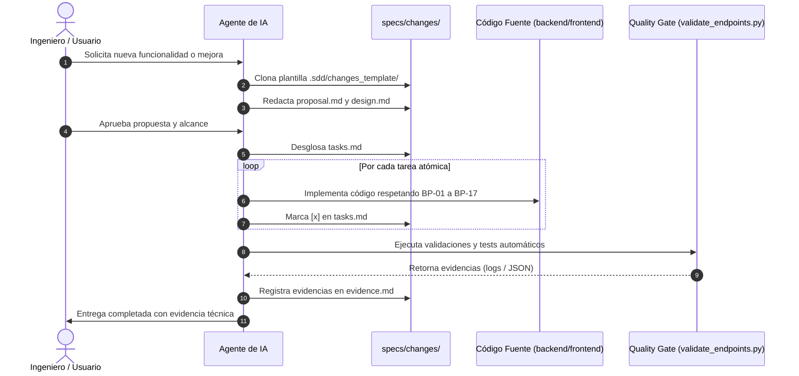

# Protocolo 14: Gestión de Cambios Atómicos y Especificaciones Vivas (Living Specs)
## Ecosistema Greenfield / Jolifoods — Metodología SDD

Este protocolo establece el estándar corporativo obligatorio para planificar, ejecutar y auditar cualquier cambio incremental, nueva característica o refactorización técnica dentro de los proyectos del ecosistema.

Inspirado en la filosofía **OpenSpec** y la disciplina de ingeniería de **Spec-Driven Development (SDD)**, este protocolo erradica el *"Vibe Coding"* y asegura que los agentes de Inteligencia Artificial operen con límites precisos, tareas atómicas y evidencia verificable.

---

## 1. El Problema del "Vibe Coding" con Agentes de IA

Cuando un desarrollador le pide a una IA cambios sin un contrato previo mediante prompts informales:
1. **La IA alucina o expande el alcance sin permiso (Scope Creep)**: Modifica archivos no relacionados, añade librerías no aprobadas o reescribe estilos existentes.
2. **Rompe componentes funcionales**: Al no tener una lista de verificación secuencial, omite casos de borde o altera contratos de endpoints.
3. **Afirma falsamente que todo funciona**: La IA responde con cortesía diciendo que *"el requerimiento ha sido completado con éxito"*, pero sin haber ejecutado validadores ni pruebas.

---

## 2. La Regla de Oro del Cambio Atómico

> **REGLA DE ORO**:
> Ningún agente de IA ni desarrollador puede alterar código fuente de un proyecto sin que exista previamente una subcarpeta aprobada en `specs/changes/[YYYY-MM-DD]-[nombre-cambio]/` con sus 4 artefactos canónicos:
> 1. `proposal.md`
> 2. `design.md`
> 3. `tasks.md`
> 4. `evidence.md`

---

## 3. Estructura y Función de los 4 Artefactos

### A. `proposal.md` (Definición de Alcance y Fronteras)
* **Objetivo de Negocio**: Por qué se hace el cambio.
* **Solución**: Qué se implementará.
* **Límites Estrictos (Out-of-Scope)**: Lista taxativa de lo que la IA **NO DEBE TOCAR**. Esto actúa como una barrera de seguridad infranqueable contra la sobreingeniería.
* **Criterios de Aceptación**: Métricas observables de éxito.

### B. `design.md` (Contratos de Datos y Arquitectura)
* **Componentes UI Reutilizados**: Referencias directas a `.sdd/components/` (prohibido CSS nuevo).
* **Contratos de Endpoints**: Entrada (Request), Salida (Response) y registro en `endpoints_registry.json`.
* **Impacto en Base de Datos**: Transaccionalidad (`with transaction.atomic():`), persistencia en bloque (`bulk_create`), y patrón Expand & Contract si hay migraciones.
* **Casos de Borde (Edge Cases)**: Respuestas a escenarios adversos (offline, 401/403, 409 duplicados, estados vacíos).

### C. `tasks.md` (Plan de Ejecución Secuencial Atómico)
* Tareas pequeñas, autónomas y verificables.
* El agente de IA debe ejecutar **una sola tarea a la vez**.
* Tras completar cada tarea y validar que compila, marca `[x]`. Si falla, se detiene y reporta.

### D. `evidence.md` (Quality Gates con Evidencia Real)
* La IA debe adjuntar la salida real de la terminal de:
  1. `python stack/validate_endpoints.py` (debe arrojar 100% de éxito).
  2. `pytest pruebas/ -v` (o tests de Playwright).
  3. Verificación de cumplimiento de las 17 Buenas Prácticas Inflexibles.

---

## 4. Flujo Operativo Paso a Paso

---

## 5. Especificaciones Vivas (Living Specs)

Cuando un requerimiento cambia a mitad del sprint o en el futuro:
1. **Primero se actualiza la especificación** (`proposal.md` o `design.md`).
2. **Luego se modifica el código**.
3. La carpeta `specs/changes/` se versiona en Git junto con el código, formando un historial vivo y auditable de la evolución del software.
