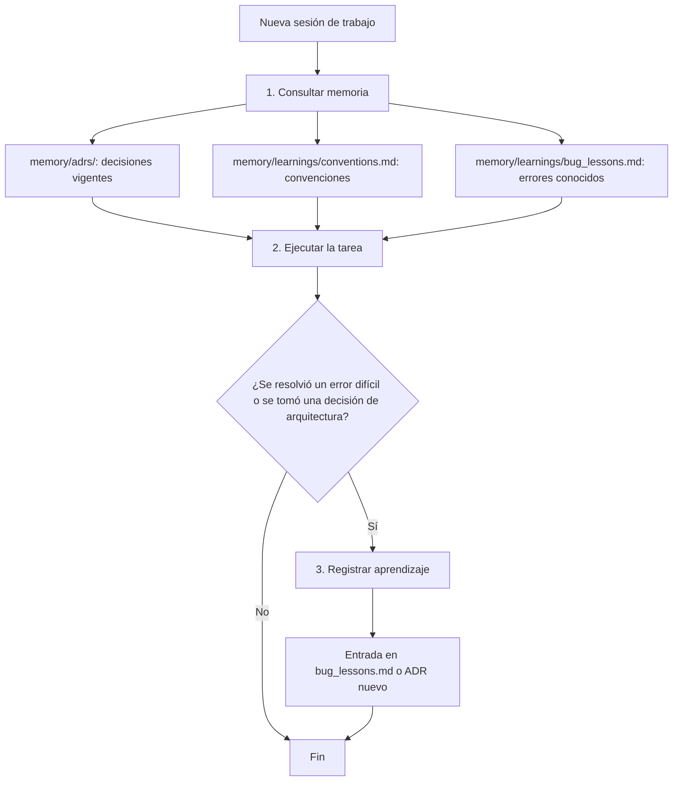

# Protocolo 15: memoria persistente del proyecto y aprendizaje continuo

Cómo conservar en el repositorio las decisiones, los errores resueltos y las convenciones de un proyecto, para que ni las personas nuevas ni los asistentes de IA (Claude Code, Cursor, GitHub Copilot, OpenCode, Antigravity, etc.) empiecen cada sesión desde cero.

Se basa en los registros de decisiones de arquitectura (**ADR**) y en catálogos de lecciones aprendidas. Plantilla: [`../memory/`](../memory/README.md).

Las palabras **DEBE / DEBERÍA / PUEDE** siguen la RFC 2119.

---

## 1. Problema que resuelve

* Un asistente de IA no recuerda sesiones anteriores: cada conversación empieza sin el contexto del proyecto.
* Sin registro escrito se repiten errores ya resueltos (concurrencia, serialización, CORS) y se vuelven a proponer alternativas que el equipo descartó.
* Se pierde tiempo reexplicando decisiones ("usamos FastAPI para lecturas y Django para permisos; no uses SQLAlchemy").

---

## 2. Ciclo de uso

---

## 3. Reglas

1. **Respetar los ADR aceptados.** Mientras un ADR esté en estado "Aceptado", no DEBERÍA proponerse una alternativa contraria salvo que una persona pida explícitamente revisarlo. Si hay razones nuevas para cambiarlo, se propone un ADR nuevo que lo reemplace, con el contexto que cambió. **Por qué:** evita reabrir decisiones sin información nueva, sin impedir que se corrijan.
2. **Consultar las lecciones antes de tocar áreas sensibles.** Antes de modificar endpoints híbridos Django/FastAPI, paginadores, migraciones o procesos masivos, se DEBERÍA revisar `bug_lessons.md`.
3. **Registrar lo aprendido.** Un error que requirió más de un intento de corrección o una investigación DEBERÍA registrarse en `bug_lessons.md` con síntoma, causa raíz, solución y regla preventiva.
4. **Sin datos sensibles.** La memoria NO DEBE contener credenciales, datos personales ni información confidencial del negocio (costos, fórmulas, recetas).
5. **Mantenimiento.** Las entradas obsoletas se marcan como tales (no se borran sin dejar rastro), para que la memoria no se convierta en ruido.

> **Estado de implementación**: la plantilla `memory/` se copia al proyecto con `stack/init_project.py`. Que un agente la lea depende de que el archivo de instrucciones del proyecto lo indique (ver §4); el SDD no verifica que se mantenga actualizada.

---

## 4. Integración con herramientas

Los archivos son Markdown plano: cualquier persona o herramienta puede leerlos. Para que un agente los consulte de forma sistemática, se referencian desde su archivo de instrucciones:

| Herramienta | Mecanismo |
|---|---|
| Claude Code | `CLAUDE.md` en la raíz (admite importar archivos con `@ruta/archivo.md`). |
| Cursor | Reglas de proyecto en `.cursor/rules/` (o el formato heredado `.cursorrules`). |
| GitHub Copilot | `.github/copilot-instructions.md`. |
| OpenCode y otros | `AGENTS.md` en la raíz. |

Opcionalmente, un servidor MCP (*Model Context Protocol*) de memoria PUEDE indexar estas notas; por ejemplo Engram (Gentleman Programming), que usa búsqueda de texto completo sobre SQLite (FTS5). El SDD no depende de ninguno: la fuente de verdad son los archivos versionados en Git.
