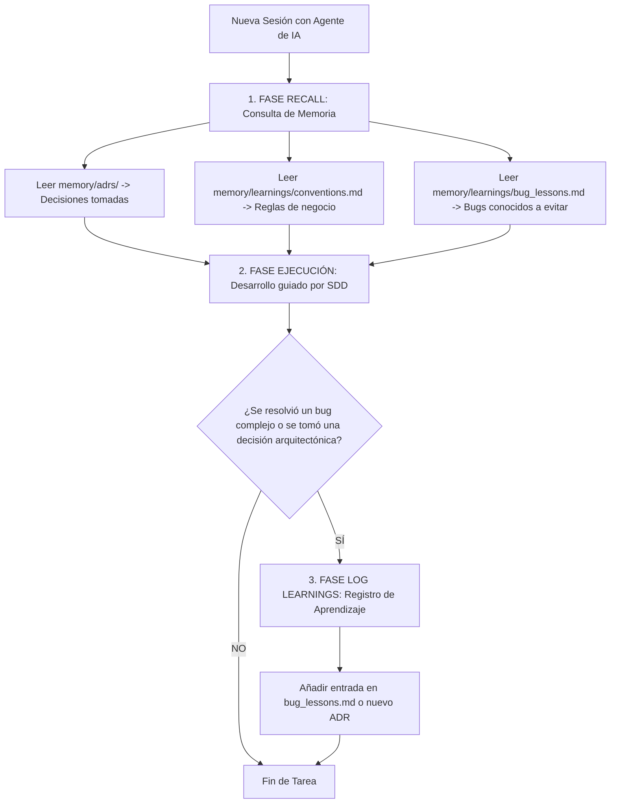

# Protocolo 15: Sistema de Memoria Persistente y Aprendizaje Continuo para Agentes de IA
## Ecosistema Greenfield / Jolifoods — Metodología SDD

Este protocolo establece los lineamientos obligatorios para eliminar la amnesia entre sesiones de los agentes de Inteligencia Artificial (Claude Code, Cursor, Antigravity, OpenCode, GitHub Copilot).

Inspirado en el sistema **Engram™** y la arquitectura de **ADRs (Architectural Decision Records)**, este protocolo garantiza que el conocimiento del proyecto no se degrade con el paso del tiempo.

---

## 1. El Fenómeno de la Amnesia del LLM y su Costo Operativo

En equipos de ingeniería tradicionales que usan IA:
* El agente empieza cada día con una "mente en blanco".
* Vuelve a cometer los mismos errores de concurrencia, serialización o CORS que ya se resolvieron la semana anterior.
* El desarrollador gasta entre 15 y 30 minutos por sesión recordándole al modelo: *"recuerda que usamos FastAPI para lectura y Django para permisos, no uses SQLAlchemy..."*.

---

## 2. Los Dos Ciclos de la Memoria Persistente

---

## 3. Normas Inflexibles de Memoria para la IA

1. **Prohibido Contradecir un ADR Aceptado**: Si existe un ADR en `memory/adrs/` en estado `Aceptado`, la IA tiene terminantemente prohibido sugerir tecnologías contrarias a menos que el usuario exprese explícitamente su intención de revocar el ADR.
2. **Consulta Obligatoria de `bug_lessons.md`**: Antes de tocar código en endpoints híbridos, paginadores, migraciones o bucles masivos, la IA debe cotejar el catálogo de bugs conocidos para no repetir errores históricos.
3. **Registro Obligatorio de Nuevas Lecciones**: Todo bug que haya requerido más de 2 intentos de corrección o investigación profunda debe registrarse inmediatamente en `memory/learnings/bug_lessons.md` con su síntoma, causa raíz, solución y regla preventiva.

---

## 4. Integración con Servidores MCP y Herramientas Externas

Este estándar de archivos Markdown estructurados está diseñado para integrarse de forma nativa con:
* **Engram™ (Gentleman Programming)**: Servidor MCP local en Go + SQLite/FTS5 que realiza búsqueda semántica sobre la carpeta `memory/`.
* **Knowledge Items (Antigravity)**: Carga contextual automática al iniciar la conversación.
* **Cursor / Claude Code**: Inyección directa en el system prompt mediante `@memory`.
