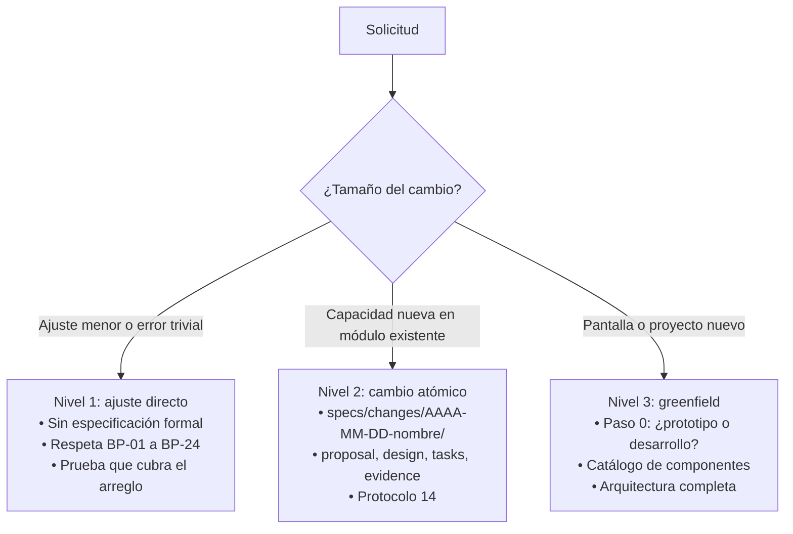

# Guía maestra del desarrollo guiado por especificaciones (SDD)

Esta guía define cómo las personas y los agentes de inteligencia artificial (IA) documentan, diseñan e implementan pantallas y módulos en proyectos de Joli Foods, tanto en proyectos nuevos (**modo greenfield**: desarrollo desde cero) como en proyectos existentes.

**Lenguaje normativo** (RFC 2119): **DEBE / NO DEBE** = obligatorio (se reserva para seguridad e integridad de datos); **DEBERÍA / NO DEBERÍA** = convención recomendada, de la que se puede apartar con una decisión registrada (ADR en `memory/adrs/`) o por pedido explícito del usuario; **PUEDE** = opcional. Las buenas prácticas **BP-01 a BP-24** se definen solo en [`00_normativa_buenas_practicas_y_auditoria.md`](./00_normativa_buenas_practicas_y_auditoria.md); aquí se citan por su código.

---

## 1. Principio: portabilidad y cero suposiciones de entorno

Una especificación del SDD DEBERÍA permitir que cualquier persona, *pipeline* de CI o agente de IA que reciba la carpeta `.sdd` construya el proyecto sin depender de rutas, redes o equipos de quien la escribió. **Por qué:** una especificación que solo funciona en un computador no es reutilizable.

1. **Rutas relativas a la raíz del proyecto** (`./frontend/`, `./backend/`). NO DEBEN usarse rutas absolutas (`C:\Users\...`, `/home/...`) ni URLs con dominio fijo en el código (BP-07).
2. **Archivos subidos en `backend/media/`**, con `.gitkeep` y volumen Docker (BP-08).
3. **Identidad visual**: los logos de `.sdd/assets/` (`Jolifoods.svg`, `Joli.svg`, `logoJoli.png`) se copian a los assets del proyecto.
4. **Árbol de archivos**: cada especificación incluye el árbol que el proyecto debe generar.
5. **Configuración por variables de entorno**: hosts, nombres de cookies, identificadores de OAuth y secretos se documentan en un `.env.example` (referencia: [`config_referencia.env.example`](./config_referencia.env.example)). NO DEBEN escribirse secretos en el código (BP-01).
6. **Contratos como fuente de verdad**: OpenAPI, esquemas Pydantic / serializadores, Zod.
7. **Memoria del proyecto**: antes de proponer cambios, consultar `memory/adrs/` y `memory/learnings/` (protocolo 15).

---

## 1.0. Proporcionalidad: tres niveles de formalidad

Para no imponer burocracia a cambios pequeños ni improvisar en cambios grandes, se usan tres niveles (en documentos anteriores se llamó "principio ODD"):



* **Nivel 1**: corrección de un texto, ajuste de un token CSS, error trivial. Se ejecuta directamente sin romper contratos ni pruebas.
* **Nivel 2**: endpoint nuevo, drawer nuevo en una vista existente, refactorización. Se documenta con [`changes_template/`](../changes_template/README.md).
* **Nivel 3**: proyecto o pantalla completa nueva. Se sigue la sección 1.1.

---

## 1.1. Preguntas iniciales (nivel 3)

Antes de generar código o estructuras para pantallas o proyectos nuevos, la IA NO DEBERÍA asumir requisitos. Empieza por el perfil de quien pide:

> **"Para darte la mejor ruta de trabajo: ¿eres desarrollador de software o tienes un perfil de negocio / no técnico?"**
>
> - **[1] Perfil de negocio** (operativo, líder funcional): se activa el **modo prototipo sin código** en `mock/`.
> - **[2] Desarrollador**: se activa el **modo arquitectura y código**.

**Por qué:** un usuario de negocio necesita ver y validar la pantalla, no decidir sobre Docker; un desarrollador necesita contratos y arquitectura.

---

### Ruta [1]: perfil de negocio — prototipo sin código

La IA genera el prototipo en `mock/<nombre_modulo>/`. Metodología completa: [`05_metodologia_mocks_no_programadores.md`](./05_metodologia_mocks_no_programadores.md); convenciones visuales: [`../mock/README.md`](../mock/README.md).

> **Sin tema por defecto**: la IA NO DEBE suponer que el módulo es de ventas o finanzas; puede ser calidad, inventario, mantenimiento, despachos, talento humano u otro. Lo que se mantiene constante es la reutilización de componentes y estilos del SDD (tarjetas KPI, tabla, estados, buscador, `ConfirmModal`).

1. **Lenguaje de negocio**: sin términos como Docker, puertos, ORM o hooks.
2. **Preguntas guía** (conversacionales):
   - **Objetivo y métricas**: "¿Qué proceso quieres gestionar y cuáles son los 3 o 4 números que necesitas ver de un vistazo?"
   - **Datos de ejemplo**: "¿Tienes una tabla de Excel con datos de ejemplo? Puedes pegar unas filas. Usa datos ficticios o anonimizados: no pegues nombres, cédulas, correos, costos ni recetas reales."
   - **Permisos**: "¿Quiénes entran a esta pantalla? ¿Hay información reservada? ¿Quién puede anular o borrar?"
   - **Acciones delicadas**: "Para anular o borrar, ¿se debe exigir un motivo escrito?"
   - **Dispositivo**: "¿Computador de oficina, o también tablet o celular en planta o bodega?"
   - **Pantalla sin datos**: "¿Qué mensaje o botón debe aparecer cuando aún no hay registros?"
3. **Entregable**: un paquete de 4 archivos más `assets/` (DEBERÍA; ver `mock/README.md` §2):
   - `<modulo>.html` (marcado), `<modulo>.css` (estilos con tokens de [`variables.css`](../components/variables.css)), `<modulo>.js` (datos `MOCK_DATA` de 20–30 registros, filtros, paginador, drawer, tema), `datos_<modulo>.md` (contrato de datos basado en [`plantilla_datos_necesarios.md`](../mock/plantilla_datos_necesarios.md)) y `assets/` con los logos.
4. **Convenciones visuales**: las 16 de [`mock/README.md` §4](../mock/README.md) (ancho completo, título en la barra superior, acciones agrupadas, drawer para crear/editar, paginador arriba de la tabla, filtros tipo Excel, tokens de color, controles accesibles, `ConfirmModal` con motivo).
5. **Entrega y pruebas**: el usuario abre el `.html` con doble clic, valida y entrega la carpeta al desarrollador. A un mock NO se le exigen pruebas automáticas ni `validate_endpoints.py` (BP-10). **Por qué:** no tiene backend; las pruebas se exigen al trasladarlo a `frontend/` y `backend/`.

---

### Ruta [2]: desarrollador — arquitectura y código

#### Reutilizar componentes antes de escribir CSS
Los módulos DEBERÍAN ensamblarse con las piezas de `.sdd/components/` y los tokens de `variables.css`, en lugar de crear hojas de estilo propias por módulo (`usuarios.css`, `productos.css`).

**Por qué:** los componentes ya resuelven tema claro/oscuro, foco y contraste; CSS paralelo duplica esfuerzo y diverge con el tiempo. **Excepción:** si un componente no cubre un caso, se mejora el componente (o se documenta la extensión en el `design.md` del cambio) en lugar de crear CSS aislado.

Piezas principales:
- **Tablas**: [`data_table.md`](../components/data_table/data_table.md) (`.joli-table`, `ChecklistPopover`, `ColumnResizer`, `ColumnVisibility`).
- **Acciones**: [`icon_action_group.md`](../components/button/icon_action_group.md) (barra de 28 px y acciones de fila de 26 px en `btn-group btn-group-sm`).
- **Filtros superiores**: [`expandable_filter_group.md`](../components/dropdown/expandable_filter_group.md).
- **Crear / editar / detalle**: [`drawer.md`](../components/drawer/drawer.md).
- **Confirmaciones y diálogos**: [`confirm_modal.md`](../components/modal/confirm_modal.md), [`modal_dialog.md`](../components/modal/modal_dialog.md).
- **Selectores**: [`select_filter.md`](../components/dropdown/select_filter.md).
- **Tokens**: [`variables.css`](../components/variables.css).

#### Documentación del proyecto (BP-16)
La documentación (`docs/` y `README.md`) DEBERÍA describir **capacidades completas** de cada módulo, no una bitácora de micro-cambios (eso ya lo registra Git):
- **Propósito y valor de negocio** del módulo.
- **Capacidades funcionales**: búsqueda, filtros, paginación en servidor, ciclo de vida de la entidad, activación/suspensión, motivos de auditoría.
- **Arquitectura**: qué endpoints sirve FastAPI (`/fast/v1/`, lecturas de alto volumen; cada endpoint declara su tipo de respuesta con modelos Pydantic) y qué gobierna Django (`/api/v1/`: modelos, permisos, escrituras). Ver ADR 0001.
- **Interfaz**: componentes de `.sdd/components/` usados.
- El `README.md` raíz mantiene la visión del producto, la lista de módulos activos y el estado del stack.

#### Escenario A: proyecto nuevo
La IA pregunta:
1. **Nombre del proyecto**: identificador corto y título visible (p. ej. `logistica`, `empaque`).
2. **Alcance de páginas**:
   - *(Recomendado)* **Completo**: inicio de sesión (local + Microsoft 365 opcional), layout, dashboard de KPIs, usuarios, roles, bitácora, perfil, configuración y páginas de error 404/403.
   - **Esencial**: inicio de sesión + layout + dashboard mínimo.
   - **Personalizado**: selección de páginas de [`pages/`](./pages/README.md).
3. **Base de datos**: **PostgreSQL** es el estándar del SDD (plantillas, Docker y pruebas lo asumen). Otro motor requiere un ADR que explique el motivo y el costo de adaptar plantillas y pruebas.
4. **Autenticación**: credenciales locales (documento + contraseña) con Microsoft 365 (Entra ID) opcional. En todos los casos aplica el modelo canónico: access token JWT solo en memoria y refresh token en cookie `HttpOnly; Secure; SameSite=Lax` (ver `pages/login/`).

El andamiaje se crea con `stack/init_project.py` (o `init_project.ps1`), que genera la estructura de la sección 3 y el `.venv`.

#### Escenario B: complemento o módulo adicional
La IA DEBERÍA mostrar el menú de complementos. El catálogo completo (32 complementos con preguntas por cada uno) está en [`02_catalogo_y_menu_de_complementos.md`](./02_catalogo_y_menu_de_complementos.md); este es el resumen de los más usados:

```text
====================================================================================================
               MENÚ DE COMPLEMENTOS (resumen — catálogo completo en 02)
====================================================================================================
 [1] Tabla avanzada tipo Excel: filtros por columna, paginación en servidor, columnas visibles, Excel.
 [2] Tablero de KPIs: tarjetas que filtran la tabla, skeletons.
 [3] Panel lateral (drawer) de detalle o edición.
 [4] Selector con búsqueda (SelectFilter), navegable con teclado.
 [5] ConfirmModal: confirmaciones con motivo, en lugar de confirm() nativo.
 [6] Avisos (ToastNotification): éxito, error, advertencia, acción opcional.
 [7] Error Boundary global con recarga ante ChunkLoadError tras un despliegue.
 [8] SessionExpirationModal: aviso de sesión vencida (evento session-expired).
 [9] EmptyState: sin datos, sin resultados o error recuperable.
[10] Roles y permisos (RBAC): matriz por módulo y acción.
[11] Primer ingreso: cambio de contraseña obligatorio con medidor de fortaleza.
[12] Capa FastAPI de lectura rápida: rutas /fast/v1, consultas sin N+1, modelos Pydantic.
====================================================================================================
```

Preguntas de seguimiento: (1) ¿en qué proyecto o carpeta se incorpora?, (2) ¿qué entidad y qué campos maneja?, (3) ¿qué permisos (no roles fijos en código; BP-19) tendrán acceso?

---

## 1.2. Diseño guiado de una página

Cuando alguien pide crear o rediseñar una página ("hagamos un CRUD", "quiero una vista de reportes"), la IA DEBERÍA guiar las decisiones antes de generar código. El flujo detallado, con un diálogo de ejemplo, está en [`03_asistente_interactivo_diseno_paginas.md`](./03_asistente_interactivo_diseno_paginas.md). Resumen:

1. **Paso 0 — perfil y tema** (sección 1.1). No asumir dominio.
2. **Paso 1 — tipo de pantalla**: [A] gestión de entidad (CRUD), [B] dashboard, [C] reporte tabular, [D] asistente por pasos, [E] dashboard de uso y mejora continua, [F] acta o inspección con firmas.
3. **Paso 2 — crear y editar**: por defecto, **panel lateral derecho (drawer)** de [`drawer.md`](../components/drawer/drawer.md) (`md` 600 px estándar, `lg` 840 px para formularios extensos). **Por qué:** mantiene visible la tabla de contexto. Excepciones, solo si el usuario lo pide o queda en un ADR: modal centrado para un dato puntual, o página dedicada (`/nuevo`, `/editar/:id`) para entidades muy extensas con pestañas y anexos.
4. **Paso 3 — capacidades de la tabla** (preseleccionadas, el usuario ajusta): filtros por columna tipo Excel, paginador arriba de la tabla (10/25/50/100), exportación a Excel respetando filtros, columnas visibles con persistencia, buscador con *debounce*, botón para limpiar filtros, encabezados fijos, tarjetas KPI que filtran.
5. **Paso 4 — controles internos** que se aplicarán:
   - Selectores con `SelectFilter` en lugar de `<select>` nativo sin estilo (DEBERÍA).
   - Confirmaciones con `ConfirmModal`; NO usar `window.confirm()` ni `window.alert()` (DEBERÍA).
   - Avisos con `ToastNotification`.
   - `EmptyState` cuando no hay resultados.

---

## 2. Estructura de `.sdd/`

```text
.sdd/
├── README.md                 # Visión general del SDD
├── assets/                   # Logos oficiales (Jolifoods.svg, Joli.svg, Joli.png, logoJoli.png)
├── components/               # 36 carpetas de componentes + variables.css / variables.md
│   └── README.md             # Catálogo de componentes
├── model/                    # Especificaciones de datos (login, roles, auditoria, archivos, telemetria)
│   └── README.md
├── stack/                    # Plantillas ejecutables: Docker, settings, asgi, init_project, validate_endpoints
│   └── README.md
├── mock/                     # Prototipos sin código: plantilla HTML y plantilla de datos
├── memory/                   # Plantilla de memoria del proyecto (ADR, lecciones, convenciones)
├── changes_template/         # Plantilla de cambios atómicos (proposal, design, tasks, evidence)
└── greenfield/
    ├── README.md             # Índice de esta carpeta
    ├── SPEC_GUIDE.md         # Esta guía
    ├── 00_ … 15_*.md         # Normativa (00), evaluación de madurez (01), catálogos (02–05) y protocolos (06–15)
    ├── config_referencia.env.example
    └── pages/                # Especificaciones de páginas (login, layout, dashboard, usuarios, roles, …)
        └── README.md
```

El detalle de cada carpeta está en su propio `README.md`, que es la fuente actualizada (este árbol se mantiene corto a propósito para no desactualizarse).

---

## 3. Estructura de un proyecto generado

```text
<proyecto>/
├── .env                          # Variables locales (no se versiona)
├── .env.example                  # Plantilla de variables (sí se versiona)
├── .gitignore                    # .venv, node_modules, .env, media/, etc.
├── .venv/                        # Entorno virtual de Python (BP-15)
├── .vscode/settings.json         # Intérprete del .venv
├── AGENTS.md / .cursorrules      # Instrucciones para agentes de IA
├── README.md
├── docker-compose.yml
├── pytest.ini                    # testpaths = pruebas; marca e2e
├── memory/                       # ADR, lecciones, convenciones (protocolo 15)
├── specs/changes/                # Cambios atómicos (protocolo 14)
├── docs/
├── frontend/
│   ├── package.json
│   ├── tsconfig.json
│   ├── vite.config.ts
│   └── src/
│       ├── config/storageKeys.ts # Claves de localStorage con prefijo de la app
│       ├── services/
│       │   ├── endpoints.ts      # Única fuente de rutas de API (BP-09)
│       │   └── apiClient.ts      # Cliente HTTP con interceptor 401 y refresh
│       ├── context/              # AuthContext (access token solo en memoria)
│       ├── schemas/              # Esquemas Zod
│       ├── types/
│       ├── hooks/
│       ├── components/           # Pruebas Vitest junto al componente (*.test.tsx)
│       └── pages/
├── backend/
│   ├── requirements.txt          # Dependencias de producción
│   ├── requirements-dev.txt      # Pruebas y calidad (pytest, ruff, pip-audit, …)
│   ├── manage.py
│   ├── media/.gitkeep            # BP-08
│   ├── config/
│   │   ├── settings.py
│   │   ├── asgi.py               # Django + FastAPI en un proceso
│   │   └── endpoints_registry.json
│   └── apps/
│       └── auth_core/            # models, serializers, views, urls, security, healthcheck
└── pruebas/                      # Todas las pruebas, fuera de backend/ (BP-17)
    ├── conftest.py
    ├── validate_endpoints.py     # Prueba de humo HTTP (copia de .sdd/stack/)
    ├── unitarias/
    ├── integracion/
    └── e2e/                      # pytest-playwright, marca e2e
```

---

## 4. Instrucciones para la IA: "crea el login a partir del SDD"

1. Leer [`pages/login/`](./pages/login/README.md) (complementos 01 a 11).
2. Crear la estructura de la sección 3 (preferiblemente con `stack/init_project.py`).
3. **Entorno de Python aislado (BP-15, DEBE)**: crear `.venv` en la raíz (`python -m venv .venv`), configurar `.vscode/settings.json` e instalar solo con el intérprete del entorno: `.\.venv\Scripts\python.exe -m pip install -r backend\requirements.txt` (Linux: `./.venv/bin/python -m pip install -r backend/requirements.txt`). NO DEBE ejecutarse `pip install` sobre el Python global. **Por qué:** mezclar dependencias globales rompe otros proyectos del equipo y hace irreproducible el entorno.
4. Implementar los contratos de `03_contrato_api_y_modelos_datos.md` sin cambiar nombres de campos ni códigos de error.
5. Aplicar la seguridad de `05_seguridad_auditoria_y_hardening.md` (cookies `HttpOnly`, limitación de intentos, sanitización).
6. Seguir el diseño y los tokens de `06_ui_ux_diseno_y_accesibilidad.md`.
7. Escribir las pruebas de `07_plan_de_pruebas_y_matriz_qa.md` (protocolo 11): Pytest en `pruebas/`, Vitest junto a los componentes, E2E en `pruebas/e2e/`.
8. **Pruebas fuera de `backend/` (BP-17)**: todas las pruebas y scripts de validación van en `<proyecto>/pruebas/`. **Por qué:** el código de producción queda limpio y la imagen Docker no incluye pruebas.
9. Verificar con `.\.venv\Scripts\python.exe pruebas\validate_endpoints.py --base-url http://localhost:8000` (contraseña de prueba en la variable `SDD_LOGIN_PASSWORD`, nunca por argumento) y registrar la salida como evidencia.

---

## 5. Prototipos para usuarios no técnicos

1. **Metodología y tabla de equivalencias HTML → React**: [`05_metodologia_mocks_no_programadores.md`](./05_metodologia_mocks_no_programadores.md).
2. **Plantillas base**:
   - [`mock/mock_template_with_json.html`](../mock/mock_template_with_json.html): plantilla completa con datos JSON, tabla, filtros, drawer y tema (carga Bootstrap, Lucide e Inter por CDN).
   - [`components/mockup_template.html`](../components/mockup_template.html): plantilla de demostración de componentes (también autocontenida).
3. **Ejemplo**: [`pages/dashboard/mockup_dashboard_ventas_ejemplo.html`](pages/dashboard/mockup_dashboard_ventas_ejemplo.html), dashboard con KPIs, tabla con filtros y cambio de tema.
4. **Integración**: el programador DEBERÍA mapear cada bloque del HTML a los componentes de `.sdd/components/` en lugar de copiar el CSS del mock.
5. **Convenciones visuales**: tabla de 16 convenciones en [`mock/README.md` §4](../mock/README.md), cada una con su justificación y su componente de referencia.
