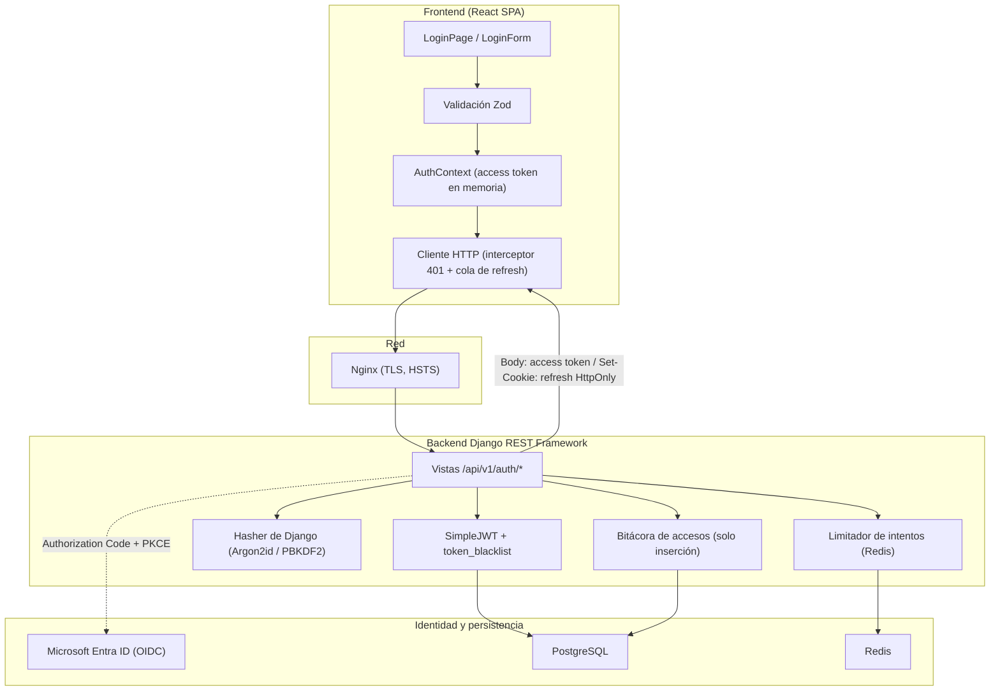
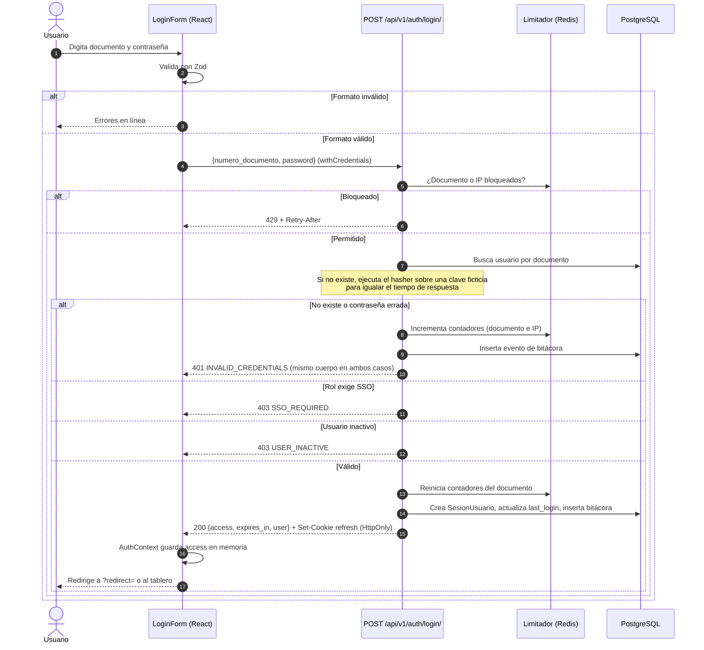
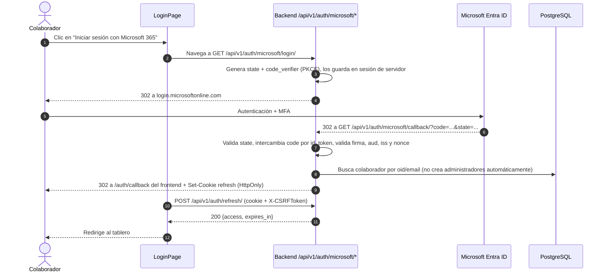
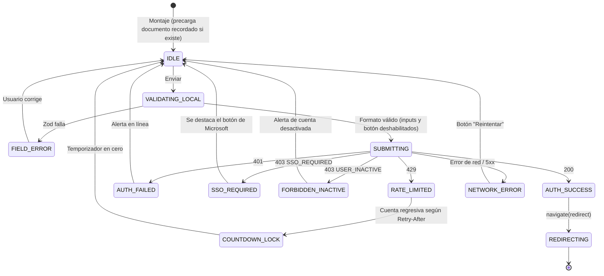

# 02. Arquitectura de Sistema y Máquinas de Estado
## Módulo de Login / Autenticación — SDD Joli Foods (`SPEC-AUTH-001`)

---

## 1. Topología

El frontend es una SPA (*Single Page Application*) en React + Vite. El backend es Django REST Framework (rutas `/api/v1/...`), con FastAPI montado en el mismo ASGI para rutas `/fast/v1/...` y las sondas `/health/live` y `/health/ready`. La identidad federada la provee Microsoft Entra ID.

---

## 2. Diagramas de Secuencia

### 2.1. Documento + contraseña

### 2.2. Microsoft SSO (sin tokens en la URL)

**Por qué:** el `code` de OAuth lo consume el backend; al frontend solo llega la cookie HttpOnly. Ningún token viaja en la URL (BP-18).

---

## 3. Máquina de Estados de la Interfaz

El temporizador de `COUNTDOWN_LOCK` DEBE limpiarse (`clearInterval`) al desmontar el componente.

---

## 4. Ciclo de Vida de la Sesión (decisión canónica)

| Paso | Comportamiento |
| :--- | :--- |
| **Emisión** | `POST /api/v1/auth/login/` devuelve el **access token** (15 min) en el cuerpo JSON y fija el **refresh token** (12 h, rotativo) en la cookie `refresh_token` con `HttpOnly; Secure; SameSite=Lax; Path=/api/v1/auth/`. También fija la cookie `csrftoken` (no HttpOnly, para que el cliente la lea). |
| **Almacenamiento en cliente** | El access token vive **solo en memoria** (estado de `AuthContext` o variable de módulo del cliente HTTP). NO DEBE guardarse en `localStorage` ni `sessionStorage`. |
| **Uso** | Cada petición API envía `Authorization: Bearer <access>`. |
| **Recuperación al recargar** | Al montar la app, `AuthContext` llama `POST /api/v1/auth/refresh/` con `withCredentials: true` y `X-CSRFToken`. Si responde 200, hay sesión; si no, el usuario queda no autenticado (sin modal). |
| **Renovación** | El interceptor ante un 401 intenta **un** refresh; las peticiones concurrentes esperan en cola el mismo refresh; si el refresh falla, despacha `session-expired` y se muestra `SessionExpirationModal`. No hay reintentos en bucle. |
| **Aviso proactivo** | El cliente PUEDE decodificar `exp` del access token en memoria para renovar o avisar antes del vencimiento (BP-20). |
| **Rotación** | Cada refresh emite un nuevo refresh token y pone el anterior en lista negra (`ROTATE_REFRESH_TOKENS = True`, `BLACKLIST_AFTER_ROTATION = True`). |
| **Cierre** | `POST /api/v1/auth/logout/` pone el refresh en lista negra, marca la `SesionUsuario` como inactiva y responde con `Set-Cookie: refresh_token=; Max-Age=0`. El cliente borra el access de memoria. |
| **Revocación global** | Cambiar o restablecer la contraseña DEBE invalidar todos los refresh tokens del usuario. |

**Por qué este diseño:** el access token en memoria no es persistente ni accesible a otras pestañas o extensiones a través del almacenamiento; el refresh en cookie HttpOnly no es legible por JavaScript (mitiga robo por XSS) y el CSRF en `/refresh/` evita que otro sitio lo use.
