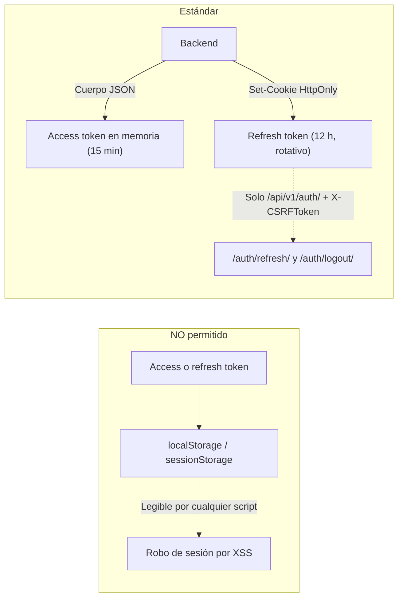

# 05. Seguridad, Auditoría y Endurecimiento (*Hardening*)
## Módulo de Login / Autenticación — SDD Joli Foods (`SPEC-AUTH-001`)

Defensas, políticas criptográficas y trazabilidad del inicio de sesión, alineadas con OWASP Top 10 (2021) y OWASP ASVS v4 (capítulos V2 Autenticación y V3 Sesiones).

---

## 1. Matriz OWASP Top 10

| Amenaza | Riesgo | Contramedida (DEBE) |
| :--- | :--- | :--- |
| **A01 Control de acceso roto** | Acceso a rutas sin sesión o con permisos insuficientes. | El backend valida firma, expiración y `is_active` en cada petición y autoriza por clave de permiso (BP-19). `ProtectedRoute` en el frontend es solo una ayuda visual, no un control de seguridad. |
| **A02 Fallas criptográficas** | Credenciales en tránsito o hashes débiles. | HTTPS + HSTS. Contraseñas con el hasher de Django: `PASSWORD_HASHERS` con `Argon2PasswordHasher` primero y `PBKDF2PasswordHasher` como alternativa (iteraciones por defecto de la versión de Django vigente). NO DEBE implementarse hashing propio. |
| **A03 Inyección** | SQL a través de `documento`. | Consultas solo por ORM (parametrizadas). Validación `^[0-9]{5,15}$` en servidor. |
| **A04 Diseño inseguro** | Recuperación de clave abusable. | Flujo de [`09_flujo_restablecimiento_contrasena.md`](./09_flujo_restablecimiento_contrasena.md): token de un solo uso con hash, 15 min, sin enumeración. |
| **A05 Configuración insegura** | `DEBUG=True`, CORS abierto, cookies sin `Secure`. | `DEBUG=False`, `CORS_ALLOWED_ORIGINS` explícito con `CORS_ALLOW_CREDENTIALS=True`, `CSRF_TRUSTED_ORIGINS`, `SESSION_COOKIE_SECURE`/`CSRF_COOKIE_SECURE = True`. |
| **A07 Fallas de identificación y autenticación** | Fuerza bruta, *credential stuffing*, enumeración. | Límite por documento e IP con espera creciente (§3); respuesta y tiempo idénticos para usuario inexistente y clave errada; MFA vía SSO en roles privilegiados. |
| **A08 Integridad de datos** | Manipulación del JWT. | Firma HS256 con `SIGNING_KEY` ≥ 256 bits desde variable de entorno (o RS256 con par de claves). Claims `exp`, `iat`, `jti`, `token_type`. Algoritmo fijo en el verificador (rechazar `alg: none`). |
| **A09 Fallas de registro y monitoreo** | Ataques sin rastro. | Bitácora de accesos solo-inserción (§4) y alertas por umbral de fallos. |

---

## 2. Transporte y Almacenamiento de la Sesión (decisión canónica)



### Directivas de la cookie `refresh_token`
| Directiva | Valor | Por qué |
| :--- | :--- | :--- |
| `HttpOnly` | sí | JavaScript no puede leerla. |
| `Secure` | sí (excepto `http://localhost` en desarrollo) | Solo viaja por HTTPS. |
| `SameSite` | `Lax` | No se adjunta en peticiones POST iniciadas por otros sitios. |
| `Path` | `/api/v1/auth/` | Solo se envía a las rutas de autenticación, no a toda la API. |
| `Max-Age` | `43200` (12 h, `JWT_REFRESH_HOURS`) | Vida acotada; se rota en cada uso. |

**CSRF:** `SameSite=Lax` no basta por sí solo (subdominios hermanos, navegadores antiguos). `/auth/refresh/` y `/auth/logout/` DEBEN exigir `X-CSRFToken` igual al valor de la cookie `csrftoken`.

**XSS:** el access token en memoria sigue expuesto mientras un script malicioso corre en la página; por eso además DEBEN aplicarse CSP (`Content-Security-Policy` sin `unsafe-inline` para scripts), escape de salida en React y prohibición de `dangerouslySetInnerHTML` con datos de usuario.

---

## 3. Protección contra Fuerza Bruta (límite y bloqueo)

Se implementa en Redis antes de tocar la contraseña:

| Clave | Umbral | Efecto |
| :--- | :--- | :--- |
| `rl:login:doc:{sha256(documento)}` | 5 fallos en 15 min | Bloqueo de 15 min (429 `Retry-After: 900`). Aplica **exista o no** el documento, para no revelar existencia. |
| `rl:login:ip:{ip}` | 20 fallos en 15 min | Bloqueo de la IP por 15 min. |
| Reincidencia del documento | Nuevo bloqueo dentro de 24 h | Bloqueo de 1 h; si el usuario existe, se fija `Usuario.bloqueado_hasta` y se alerta a seguridad. |

- Un login exitoso reinicia el contador del documento (no el de la IP).
- La IP se obtiene de `X-Forwarded-For` **solo** si la petición viene del proxy de confianza (`TRUSTED_PROXIES`); en otro caso, de `REMOTE_ADDR`.
- Si Redis no está disponible, el login DEBE fallar cerrado con 503 (no omitir el límite). La sonda `/health/ready` reporta ese estado.
- Para igualar tiempos, cuando el documento no existe se ejecuta `make_password()` sobre un valor fijo antes de responder 401.

---

## 4. Bitácora de Accesos

Cada evento se inserta en `RegistroAuditoriaAcceso` ([`../../../model/login/spec_model_sesion_auditoria.md`](../../../model/login/spec_model_sesion_auditoria.md)). La tabla es **solo-inserción**: el usuario de base de datos de la aplicación NO DEBE tener permisos `UPDATE`/`DELETE` sobre ella y el modelo bloquea modificaciones.

```json
{
  "fecha_evento": "2026-09-30T11:45:00Z",
  "evento": "LOGIN_SUCCESS_CREDENTIALS",
  "resultado": "SUCCESS",
  "documento_ingresado": "1000000001",
  "usuario_id": 42,
  "ip_origen": "192.0.2.45",
  "user_agent": "Mozilla/5.0 (...)",
  "tiempo_respuesta_ms": 142
}
```

Catálogo de eventos (fuente única: el modelo): `LOGIN_SUCCESS_CREDENTIALS`, `LOGIN_SUCCESS_SSO`, `LOGIN_FAILED_BAD_PASSWORD`, `LOGIN_FAILED_NOT_FOUND`, `LOGIN_BLOCKED_INACTIVE`, `LOGIN_BLOCKED_SSO_REQUIRED`, `LOGIN_BLOCKED_RATE_LIMIT`, `TOKEN_REFRESH_REUSED`, `LOGOUT_VOLUNTARY`, `SESSION_EXPIRED`, `PASSWORD_RESET_REQUESTED`, `PASSWORD_RESET_COMPLETED`, `PASSWORD_CHANGED`.

Nunca se registra la contraseña ni el token. La retención de la bitácora (p. ej. 1 año) DEBE definirse con el área de seguridad y cumplir la Ley 1581 de 2012 de protección de datos.

---

## 5. Sesión Vencida (BP-20)

```mermaid
sequenceDiagram
    autonumber
    actor U as Usuario
    participant FE as AuthContext / cliente HTTP
    participant API as Backend
    participant MODAL as SessionExpirationModal

    alt Proactiva
        FE->>FE: exp del access en memoria cerca de vencer
        FE->>API: POST /api/v1/auth/refresh/ (cookie + X-CSRFToken)
    else Reactiva
        FE->>API: GET /api/v1/recurso/ (Bearer)
        API-->>FE: 401
        FE->>API: POST /api/v1/auth/refresh/ (una sola vez; peticiones concurrentes en cola)
    end
    alt Refresh OK
        API-->>FE: 200 {access}
        FE->>API: Reintenta las peticiones en cola
    else Refresh falla
        API-->>FE: 401 REFRESH_INVALID
        FE->>FE: window.dispatchEvent(new Event('session-expired'))
        FE->>MODAL: Abre el modal (bloquea el fondo)
        U->>MODAL: "Volver a iniciar sesión"
        MODAL->>FE: Borra access de memoria y usuario del contexto
        FE->>U: navigate('/login?redirect=/ruta-previa')
    end
```

Reglas:
1. La sesión vencida DEBERÍA comunicarse con [`SessionExpirationModal`](../../../components/modal/session_expiration_modal.md); NO DEBERÍA recargarse la página sin aviso. **Por qué:** el usuario pierde datos sin saber por qué.
2. La limpieza DEBE ser idempotente: borrar el access de memoria y el usuario del contexto. No hay tokens que borrar en `localStorage` porque nunca se guardaron allí.
3. El interceptor NO DEBE reintentar el refresh más de una vez por ciclo (evita bucles de 401).
