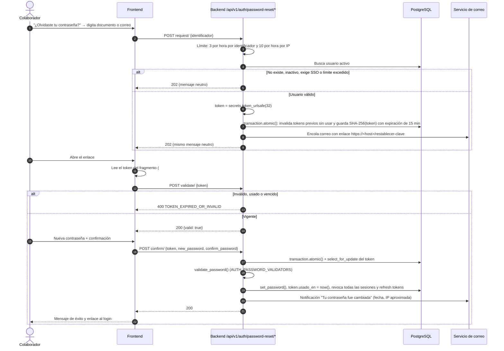

# 09. Flujo de Restablecimiento de Contraseña
## Módulo de Login / Autenticación — SDD Joli Foods (`SPEC-AUTH-RESET`)

Arquitectura, contratos y reglas de seguridad para recuperar una contraseña olvidada. Modelo de datos: [`../../../model/login/spec_model_restablecimiento.md`](../../../model/login/spec_model_restablecimiento.md). Componentes de interfaz: [`recovery_form.md`](../../../components/login/recovery_form.md) y [`email_recovery_template.md`](../../../components/login/email_recovery_template.md).

---

## 1. Secuencia



**Por qué el token va en el fragmento `#`:** el fragmento no se envía al servidor en la petición GET de la página, así que no queda en logs de Nginx ni en la cabecera `Referer` (BP-18, excepción de enlace de un solo uso).

---

## 2. Contratos

### 2.1. `POST /api/v1/auth/password-reset/request/`
```json
{ "identificador": "1000000001" }
```
`identificador` acepta documento o correo.

**202 Accepted — siempre el mismo cuerpo, exista o no la cuenta:**
```json
{ "message": "Si los datos corresponden a una cuenta activa, recibirás un enlace en tu correo en los próximos minutos." }
```
El envío del correo DEBERÍA hacerse en segundo plano (tarea Celery o similar) para que el tiempo de respuesta no revele si la cuenta existe.

### 2.2. `POST /api/v1/auth/password-reset/validate/`
```json
{ "token": "<token del enlace>" }
```
- **200:** `{ "valid": true }` — no devuelve correo ni nombre (el portador del enlace aún no ha demostrado nada más).
- **400:** `{ "valid": false, "error_code": "TOKEN_EXPIRED_OR_INVALID", "message": "El enlace es inválido o venció. Solicita uno nuevo." }`

### 2.3. `POST /api/v1/auth/password-reset/confirm/`
```json
{ "token": "<token del enlace>", "new_password": "<NUEVA_CONTRASEÑA>", "confirm_password": "<NUEVA_CONTRASEÑA>" }
```
- **200:** `{ "message": "Tu contraseña fue actualizada. Inicia sesión con la nueva contraseña." }`
- **400:** `TOKEN_EXPIRED_OR_INVALID`, `PASSWORD_MISMATCH` o `PASSWORD_POLICY` (con la lista de reglas incumplidas).

---

## 3. Reglas de Seguridad (DEBE)

| # | Regla | Por qué |
| :--- | :--- | :--- |
| 1 | Token de **32 bytes** de `secrets.token_urlsafe`. | Imposible de adivinar por fuerza bruta. |
| 2 | En base de datos solo se guarda **SHA-256 del token**; la búsqueda se hace por hash. | Una fuga de la BD no permite usar los enlaces. |
| 3 | **Vigencia de 15 minutos** (`PASSWORD_RESET_MINUTES`). | Reduce la ventana de abuso de un correo interceptado. |
| 4 | **Un solo uso:** se marca `usado_en` dentro de `transaction.atomic()` con `select_for_update()`. | Evita doble consumo concurrente. |
| 5 | **Un solo token vigente** por usuario: una nueva solicitud invalida las anteriores. | Los enlaces viejos dejan de servir. |
| 6 | **Respuesta idéntica** (cuerpo, código y tiempo aproximado) exista o no la cuenta. | Evita la enumeración de usuarios. |
| 7 | **Límite de tasa:** 3 solicitudes/hora por identificador, 10/hora por IP; 10 intentos de `validate`/`confirm` por IP cada 15 min. | Frena abuso del correo y adivinación de tokens. |
| 8 | Al confirmar: `validate_password()` y `set_password()` (hasher de Django). | Política de claves única y hash estándar. |
| 9 | Al confirmar: **invalidar todas las sesiones** (`OutstandingToken` del usuario a lista negra y `SesionUsuario.is_activa = False`). | Expulsa a quien tuviera una sesión robada. |
| 10 | Notificar el cambio por correo. | El titular detecta cambios no autorizados. |
| 11 | Cuentas con rol `exige_sso` NO usan este flujo (su clave se gestiona en Entra ID). | Evita una puerta trasera a cuentas privilegiadas. |
| 12 | Registrar `PASSWORD_RESET_REQUESTED` y `PASSWORD_RESET_COMPLETED` en la bitácora, sin el token. | Trazabilidad. |
