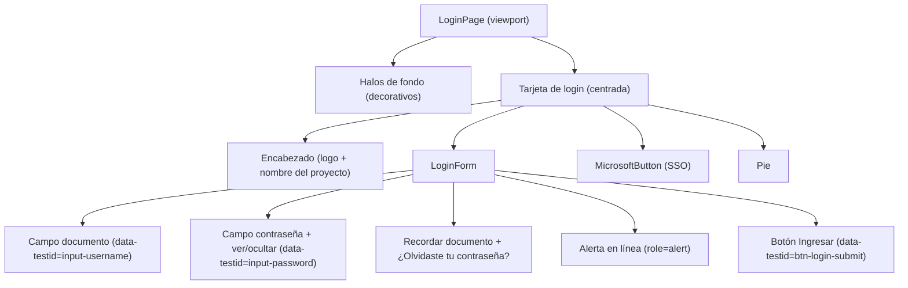

# 11. Componentes de la Página de Login (`PAGE-LOGIN-COMPONENTS`)
## Módulo de Login / Autenticación — SDD Joli Foods (`SPEC-AUTH-001`)

Composición de componentes de la página de login, su CSS (solo tokens de [`variables.css`](../../../components/variables.css)) y el ensamblaje final. Diseño y accesibilidad en [`06_ui_ux_diseno_y_accesibilidad.md`](./06_ui_ux_diseno_y_accesibilidad.md); componentes atómicos en [`.sdd/components/login/`](../../../components/login/README.md).

---

## 1. Árbol de Composición



`SessionExpirationModal` no forma parte del login: se monta en el layout autenticado (ver [`../layout/01_layout_maestro_especificacion.md`](../layout/01_layout_maestro_especificacion.md)).

---

## 2. CSS de la Página (`LoginPage.css`)

```css
/* Viewport: la tarjeta de login es una excepción permitida de centrado */
.joli-login-viewport {
  position: relative;
  min-height: 100vh;
  width: 100%;
  display: flex;
  align-items: center;
  justify-content: center;
  padding: 1.5rem;
  overflow: hidden;
  background-color: var(--bg-viewport);
  font-family: var(--font-family);
}

.joli-login-orb {
  position: absolute;
  border-radius: var(--radius-full);
  filter: blur(100px);
  pointer-events: none;
}
.joli-login-orb--top    { width: 450px; height: 450px; top: -15%; right: -10%;
                          background: radial-gradient(circle, var(--orb-color-primary) 0%, transparent 70%); }
.joli-login-orb--bottom { width: 400px; height: 400px; bottom: -15%; left: -10%;
                          background: radial-gradient(circle, var(--orb-color-secondary) 0%, transparent 70%); }

.joli-login-card {
  position: relative;
  z-index: var(--z-card);
  width: 100%;
  max-width: 440px; /* ancho de tarjeta, no de página */
  background: var(--glass-bg);
  backdrop-filter: var(--glass-blur);
  -webkit-backdrop-filter: var(--glass-blur);
  border: 1px solid var(--glass-border);
  border-top-color: var(--border-card-accent);
  border-radius: var(--radius-2xl);
  box-shadow: var(--glass-shadow);
  padding: 2.5rem 2rem;
}

.joli-login-header { display: flex; flex-direction: column; align-items: center; text-align: center; margin-bottom: 2rem; }
.joli-login-logo   { width: 64px; height: 64px; margin-bottom: 1rem; }
.joli-login-title  { margin: 0; font-size: var(--font-size-2xl); font-weight: var(--font-weight-extrabold); color: var(--text-primary); }
.joli-login-subtitle { margin: 0.35rem 0 0; font-size: var(--font-size-sm); color: var(--text-muted); }

.joli-login-field { margin-bottom: 1.25rem; }
.joli-login-label { display: block; margin-bottom: 0.375rem; font-size: var(--font-size-sm); font-weight: var(--font-weight-medium); color: var(--label-color); }
.joli-login-input-wrapper { position: relative; display: flex; align-items: center; }
.joli-login-icon-prefix { position: absolute; left: 0.75rem; width: 20px; height: 20px; color: var(--text-muted); pointer-events: none; }
.joli-login-input {
  width: 100%;
  height: var(--input-height);
  padding: 0 0.75rem 0 2.5rem;
  background: var(--input-bg);
  color: var(--input-text);
  border: 1px solid var(--input-border);
  border-radius: var(--radius-md);
  font-size: var(--font-size-base);
  transition: border-color var(--transition-fast), box-shadow var(--transition-fast);
}
.joli-login-input::placeholder { color: var(--input-placeholder); }
.joli-login-input:focus-visible { outline: none; border-color: var(--input-focus-border); box-shadow: var(--shadow-input-focus); }
.joli-login-input[aria-invalid='true'] { border-color: var(--border-error); }
.joli-login-input--suffix { padding-right: 2.75rem; }
.joli-login-icon-suffix {
  position: absolute; right: 0.5rem; display: inline-flex; padding: 0.25rem;
  background: transparent; border: 0; border-radius: var(--radius-sm); color: var(--text-muted); cursor: pointer;
}
.joli-login-icon-suffix:focus-visible { outline: 2px solid var(--border-focus); outline-offset: 2px; }
.joli-login-error-text { display: block; margin-top: 0.25rem; font-size: var(--font-size-xs); color: var(--status-error); }

.joli-login-options { display: flex; align-items: center; justify-content: space-between; gap: 0.5rem; flex-wrap: wrap;
                      margin: 0.25rem 0 1.5rem; font-size: var(--font-size-xs); }
.joli-login-checkbox { display: flex; align-items: center; gap: 0.5rem; color: var(--text-secondary); cursor: pointer; }
.joli-login-checkbox input { accent-color: var(--brand-primary); width: 1rem; height: 1rem; }
.joli-login-link { color: var(--brand-primary-light); font-weight: var(--font-weight-medium); text-decoration: none; }
.joli-login-link:hover, .joli-login-link:focus-visible { text-decoration: underline; }

.joli-login-alert {
  display: flex; align-items: flex-start; gap: 0.5rem; margin-bottom: 1rem; padding: 0.75rem;
  background: var(--alert-error-bg); border: 1px solid var(--alert-error-border);
  border-radius: var(--radius-md); color: var(--alert-error-text); font-size: var(--font-size-sm);
}

.joli-login-submit {
  width: 100%; height: 44px; display: inline-flex; align-items: center; justify-content: center; gap: 0.5rem;
  background: var(--brand-primary); color: var(--text-on-brand); border: 0; border-radius: var(--radius-md);
  font-weight: var(--font-weight-semibold); cursor: pointer;
  transition: background-color var(--transition-fast), box-shadow var(--transition-fast);
}
.joli-login-submit:hover:not(:disabled) { background: var(--brand-primary-hover); box-shadow: 0 10px 25px -5px var(--brand-glow); }
.joli-login-submit:focus-visible { outline: 2px solid var(--border-focus); outline-offset: 2px; }
.joli-login-submit:disabled { opacity: 0.75; cursor: not-allowed; }
.joli-login-spin { animation: joli-login-spin 0.8s linear infinite; }
@keyframes joli-login-spin { to { transform: rotate(360deg); } }

.joli-login-divider { display: flex; align-items: center; gap: 1rem; margin: 1.5rem 0; }
.joli-login-divider::before, .joli-login-divider::after { content: ''; flex: 1; height: 1px; background: var(--border-subtle); }
.joli-login-divider span { font-size: var(--font-size-2xs); text-transform: uppercase; letter-spacing: 0.08em; color: var(--text-tertiary); }

.joli-login-microsoft {
  width: 100%; height: 44px; display: inline-flex; align-items: center; justify-content: center; gap: 0.75rem;
  background: var(--bg-btn-secondary); color: var(--text-primary); border: 1px solid var(--border-subtle);
  border-radius: var(--radius-md); font-weight: var(--font-weight-medium); cursor: pointer;
}
.joli-login-microsoft:hover:not(:disabled) { background: var(--bg-btn-secondary-hover); }
.joli-login-microsoft:focus-visible { outline: 2px solid var(--border-focus); outline-offset: 2px; }
.joli-login-microsoft--highlight { border-color: var(--brand-primary); box-shadow: 0 0 0 3px var(--brand-glow); }

.joli-login-footer { margin-top: 2rem; text-align: center; font-size: var(--font-size-xs); color: var(--text-tertiary); }

@media (max-width: 480px) { .joli-login-card { padding: 2rem 1.25rem; } }
@media (prefers-reduced-motion: reduce) { .joli-login-spin { animation: none; } }
```

Los colores del logo de Microsoft (`#f25022`, `#00a4ef`, `#7fba00`, `#ffb900`) son una excepción válida: forman parte del SVG de marca de un tercero.

---

## 3. Ensamblaje (`LoginPage.tsx`)

Usa `AuthContext` (access token en memoria, refresh en cookie HttpOnly) — nunca guarda tokens en el navegador. Las rutas salen de `ENDPOINTS`.

```tsx
import { useEffect, useRef, useState } from 'react';
import { useForm } from 'react-hook-form';
import { zodResolver } from '@hookform/resolvers/zod';
import { useNavigate, useSearchParams } from 'react-router-dom';
import { isAxiosError } from 'axios';
import { IdCard, Lock, Eye, EyeOff, LogIn, Loader2, AlertCircle } from 'lucide-react';
import { loginSchema, type LoginFormData } from '../schemas/auth.schema';
import { useAuth } from '../context/AuthContext';
import { apiClient } from '../services/apiClient';
import { ENDPOINTS } from '../services/endpoints';
import { STORAGE_KEYS, safeStorage } from '../config/storageKeys';
import { showToast } from '../components/ToastNotification';
import logoUrl from '../assets/Jolifoods.svg';
import './LoginPage.css';

const APP_NAME = import.meta.env.VITE_APP_NAME ?? 'Aplicación';

interface ApiError { error_code?: string; message?: string; retry_after_seconds?: number }

/** Solo se permiten redirecciones internas (evita open redirect). */
function safeRedirect(target: string | null): string {
  return target && target.startsWith('/') && !target.startsWith('//') ? target : '/dashboard';
}

export function LoginPage() {
  const { login } = useAuth();
  const navigate = useNavigate();
  const [params] = useSearchParams();
  const [showPassword, setShowPassword] = useState(false);
  const [errorMessage, setErrorMessage] = useState<string | null>(null);
  const [ssoRequired, setSsoRequired] = useState(false);
  const [lockSeconds, setLockSeconds] = useState(0);
  const timerRef = useRef<number | null>(null);

  const remembered = safeStorage.get(STORAGE_KEYS.rememberedDoc);
  const {
    register,
    handleSubmit,
    formState: { errors, isSubmitting },
  } = useForm<LoginFormData>({
    resolver: zodResolver(loginSchema),
    defaultValues: { numero_documento: remembered ?? '', password: '', rememberMe: Boolean(remembered) },
  });

  // Cuenta regresiva del bloqueo (429) con limpieza al desmontar
  const isLocked = lockSeconds > 0;
  useEffect(() => {
    if (!isLocked) return;
    timerRef.current = window.setInterval(() => {
      setLockSeconds((s) => (s <= 1 ? 0 : s - 1));
    }, 1000);
    return () => {
      if (timerRef.current !== null) window.clearInterval(timerRef.current);
    };
  }, [isLocked]);

  // Error devuelto por el callback de SSO (?error=sso_failed)
  useEffect(() => {
    if (params.get('error') === 'sso_failed') {
      setErrorMessage('No fue posible iniciar sesión con Microsoft. Intenta de nuevo.');
    }
  }, [params]);

  const onSubmit = async (data: LoginFormData) => {
    setErrorMessage(null);
    try {
      const user = await login({ numero_documento: data.numero_documento, password: data.password }); // POST /auth/login/, guarda access en memoria
      if (data.rememberMe) safeStorage.set(STORAGE_KEYS.rememberedDoc, data.numero_documento);
      else safeStorage.remove(STORAGE_KEYS.rememberedDoc);
      showToast.success('Inicio de sesión exitoso', { description: `Bienvenido, ${user.nombre}.` });
      navigate(user.debe_cambiar_clave ? '/primer-ingreso' : safeRedirect(params.get('redirect')), { replace: true });
    } catch (err: unknown) {
      const body: ApiError | undefined = isAxiosError<ApiError>(err) ? err.response?.data : undefined;
      const status = isAxiosError(err) ? err.response?.status : undefined;
      if (status === 429) {
        setLockSeconds(body?.retry_after_seconds ?? 60);
        setErrorMessage('Demasiados intentos. Espera antes de volver a intentar.');
      } else if (body?.error_code === 'SSO_REQUIRED') {
        setSsoRequired(true);
        setErrorMessage('Tu cuenta debe iniciar sesión con Microsoft 365.');
      } else if (status === 401 || status === 403) {
        setErrorMessage(body?.message ?? 'Documento o contraseña incorrectos.');
      } else {
        setErrorMessage('No fue posible conectar con el servidor. Intenta de nuevo.');
      }
    }
  };

  const handleMicrosoftLogin = () => {
    // Navegación completa: el backend gestiona state + PKCE y devuelve la cookie HttpOnly
    window.location.assign(`${apiClient.defaults.baseURL ?? ''}${ENDPOINTS.AUTH.MICROSOFT_LOGIN}`);
  };

  const blocked = isSubmitting || isLocked;

  return (
    <main className="joli-login-viewport">
      <div className="joli-login-orb joli-login-orb--top" aria-hidden="true" />
      <div className="joli-login-orb joli-login-orb--bottom" aria-hidden="true" />

      <section className="joli-login-card" aria-labelledby="login-title">
        <header className="joli-login-header">
          
          <h1 id="login-title" className="joli-login-title">{APP_NAME}</h1>
          <p className="joli-login-subtitle">Ingresa tus datos para acceder a la plataforma</p>
        </header>

        <form onSubmit={handleSubmit(onSubmit)} noValidate>
          <div className="joli-login-field">
            <label htmlFor="login-document" className="joli-login-label">Número de documento</label>
            <div className="joli-login-input-wrapper">
              <IdCard className="joli-login-icon-prefix" aria-hidden="true" />
              <input
                id="login-document"
                data-testid="input-username"
                type="text"
                inputMode="numeric"
                autoComplete="username"
                placeholder="Ej. 1000000001"
                className="joli-login-input"
                aria-invalid={errors.numero_documento ? 'true' : 'false'}
                aria-describedby={errors.numero_documento ? 'login-document-error' : undefined}
                disabled={blocked}
                {...register('numero_documento')}
              />
            </div>
            {errors.numero_documento && (
              <span id="login-document-error" className="joli-login-error-text">{errors.numero_documento.message}</span>
            )}
          </div>

          {!ssoRequired && (
            <div className="joli-login-field">
              <label htmlFor="login-password" className="joli-login-label">Contraseña</label>
              <div className="joli-login-input-wrapper">
                <Lock className="joli-login-icon-prefix" aria-hidden="true" />
                <input
                  id="login-password"
                  data-testid="input-password"
                  type={showPassword ? 'text' : 'password'}
                  autoComplete="current-password"
                  className="joli-login-input joli-login-input--suffix"
                  aria-invalid={errors.password ? 'true' : 'false'}
                  aria-describedby={errors.password ? 'login-password-error' : undefined}
                  disabled={blocked}
                  {...register('password')}
                />
                <button
                  type="button"
                  className="joli-login-icon-suffix"
                  onClick={() => setShowPassword((v) => !v)}
                  aria-label={showPassword ? 'Ocultar contraseña' : 'Mostrar contraseña'}
                  aria-pressed={showPassword}
                >
                  {showPassword ? <EyeOff size={20} aria-hidden="true" /> : <Eye size={20} aria-hidden="true" />}
                </button>
              </div>
              {errors.password && (
                <span id="login-password-error" className="joli-login-error-text">{errors.password.message}</span>
              )}
            </div>
          )}

          <div className="joli-login-options">
            <label className="joli-login-checkbox">
              <input type="checkbox" {...register('rememberMe')} />
              <span>Recordar mi documento</span>
            </label>
            <a href="/recuperar-clave" className="joli-login-link">¿Olvidaste tu contraseña?</a>
          </div>

          {errorMessage && (
            <div className="joli-login-alert" role="alert">
              <AlertCircle size={16} aria-hidden="true" />
              <span>{errorMessage}{lockSeconds > 0 ? ` (${lockSeconds} s)` : ''}</span>
            </div>
          )}

          {!ssoRequired && (
            <button type="submit" data-testid="btn-login-submit" className="joli-login-submit" disabled={blocked}>
              {isSubmitting ? (
                <>
                  <Loader2 size={18} className="joli-login-spin" aria-hidden="true" />
                  <span>Ingresando…</span>
                </>
              ) : (
                <>
                  <LogIn size={18} aria-hidden="true" />
                  <span>Ingresar</span>
                </>
              )}
            </button>
          )}
        </form>

        <div className="joli-login-divider"><span>o continúa con</span></div>

        <button
          type="button"
          onClick={handleMicrosoftLogin}
          disabled={isSubmitting}
          className={`joli-login-microsoft ${ssoRequired ? 'joli-login-microsoft--highlight' : ''}`}
        >
          <svg width="20" height="20" viewBox="0 0 21 21" aria-hidden="true">
            <path fill="#f25022" d="M1 1h9v9H1z" />
            <path fill="#00a4ef" d="M1 11h9v9H1z" />
            <path fill="#7fba00" d="M11 1h9v9h-9z" />
            <path fill="#ffb900" d="M11 11h9v9h-9z" />
          </svg>
          <span>Iniciar sesión con Microsoft 365</span>
        </button>

        <footer className="joli-login-footer">
          <p>Joli Foods • Acceso corporativo</p>
        </footer>
      </section>
    </main>
  );
}
```

Notas:
- `<CorporateToaster />` se monta una sola vez en la raíz de la app, no en esta página.
- El `useEffect` del temporizador depende de `isLocked` para crear un único intervalo por bloqueo y limpiarlo al terminar o al desmontar.
- `safeRedirect` evita redirecciones abiertas a dominios externos mediante `?redirect=`.
