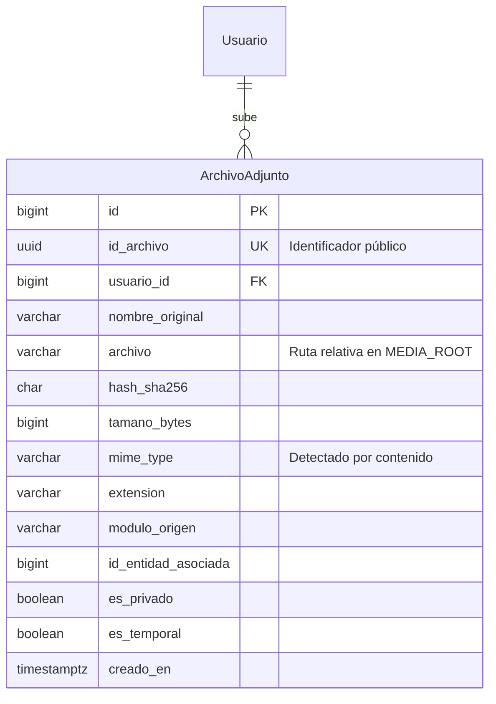

# Especificación de Modelos de Datos — Archivos Adjuntos y Media
## Joli Foods — Spec-Driven Development (SDD)
### Módulo: `archivos` (BP-07, BP-08 y `FileUploaderPro`)

Persistencia segura de archivos adjuntos (PDF, evidencias fotográficas, firmas, soportes) en `backend/media/`, con rutas relativas, validación de tipo y tamaño, deduplicación por SHA-256 y descarga controlada de archivos sensibles.

---

## 1. Reglas de Seguridad (DEBE)

| # | Regla | Por qué |
| :--- | :--- | :--- |
| 1 | **Lista blanca de tipos** por contenido real (*magic bytes*), no por extensión ni por el `Content-Type` que envía el navegador. Tipos por defecto: `application/pdf`, `image/jpeg`, `image/png`, `image/webp`. | La extensión y la cabecera las controla quien sube el archivo. |
| 2 | **Tamaño máximo** por tipo (`MEDIA_MAX_BYTES`, por defecto 10 MB; avatares 2 MB) validado en el serializer **y** en Nginx (`client_max_body_size`). | Evita agotar disco y memoria. |
| 3 | **Nombre en disco = UUID** + extensión normalizada; el nombre original solo se guarda en BD y se escapa al mostrarlo. | Evita *path traversal* y sobrescrituras. |
| 4 | **Archivos sensibles** (`es_privado = true`: firmas, documentos de identidad, soportes contables) se guardan en `media/privado/`, que Nginx NO sirve; se descargan por `GET /api/v1/archivos/{id_archivo}/descargar/`, que verifica permiso y responde con `X-Accel-Redirect`. | Una URL adivinable o compartida no debe dar acceso a datos personales. |
| 5 | Archivos públicos (p. ej. avatares) PUEDEN servirse desde `media/publico/`; su ruta usa UUID, no datos del usuario. | Rendimiento sin exponer información. |
| 6 | Imágenes: se re-codifican con Pillow para eliminar metadatos EXIF (ubicación GPS). SVG NO se acepta como imagen subida. | El EXIF filtra ubicación; el SVG puede contener scripts. |
| 7 | Descargas con `Content-Disposition: attachment` y `X-Content-Type-Options: nosniff`. | Evita que el navegador ejecute contenido subido. |

---

## 2. Esquema



---

## 3. DDL (PostgreSQL)

```sql
CREATE TABLE media_archivo_adjunto (
    id                  BIGSERIAL    PRIMARY KEY,
    id_archivo          UUID         NOT NULL DEFAULT gen_random_uuid(),
    usuario_id          BIGINT       NULL REFERENCES usuarios(id) ON DELETE SET NULL,
    nombre_original     VARCHAR(255) NOT NULL,
    archivo             VARCHAR(500) NOT NULL,
    hash_sha256         CHAR(64)     NOT NULL,
    tamano_bytes        BIGINT       NOT NULL,
    mime_type           VARCHAR(100) NOT NULL,
    extension           VARCHAR(10)  NOT NULL,
    modulo_origen       VARCHAR(80)  NOT NULL,
    id_entidad_asociada BIGINT       NULL,
    es_privado          BOOLEAN      NOT NULL DEFAULT TRUE,
    es_temporal         BOOLEAN      NOT NULL DEFAULT FALSE,
    creado_en           TIMESTAMPTZ  NOT NULL DEFAULT CURRENT_TIMESTAMP,
    CONSTRAINT uq_archivo_id_archivo UNIQUE (id_archivo),
    CONSTRAINT chk_archivo_tamano CHECK (tamano_bytes > 0)
);

CREATE INDEX idx_archivo_hash_sha256     ON media_archivo_adjunto (hash_sha256);
CREATE INDEX idx_archivo_modulo_entidad  ON media_archivo_adjunto (modulo_origen, id_entidad_asociada);
CREATE INDEX idx_archivo_usuario_fecha   ON media_archivo_adjunto (usuario_id, creado_en DESC);
```

---

## 4. Django ORM

### 4.1. Validadores (`backend/apps/archivos/validators.py`)

```python
import uuid
from pathlib import Path

import filetype  # detección por magic bytes (agregar "filetype" a requirements.txt)
from django.conf import settings
from django.core.exceptions import ValidationError

TIPOS_PERMITIDOS = {
    "application/pdf": ".pdf",
    "image/jpeg": ".jpg",
    "image/png": ".png",
    "image/webp": ".webp",
}
TIPOS_IMAGEN = {"image/jpeg", "image/png", "image/webp"}


def detectar_mime(archivo) -> str:
    cabecera = archivo.read(2048)
    archivo.seek(0)
    tipo = filetype.guess(cabecera)
    if tipo is None or tipo.mime not in TIPOS_PERMITIDOS:
        raise ValidationError("Tipo de archivo no permitido.")
    return tipo.mime


def validar_archivo(archivo) -> None:
    maximo = getattr(settings, "MEDIA_MAX_BYTES", 10 * 1024 * 1024)
    if archivo.size > maximo:
        raise ValidationError(f"El archivo supera el máximo de {maximo // (1024 * 1024)} MB.")
    detectar_mime(archivo)


def validar_imagen_avatar(archivo) -> None:
    if archivo.size > 2 * 1024 * 1024:
        raise ValidationError("La imagen supera 2 MB.")
    if detectar_mime(archivo) not in TIPOS_IMAGEN:
        raise ValidationError("El avatar debe ser JPG, PNG o WEBP.")


def ruta_avatar(instance, filename: str) -> str:
    ext = Path(filename).suffix.lower()
    return f"publico/avatares/{uuid.uuid4()}{ext}"
```

### 4.2. Modelo (`backend/apps/archivos/models.py`)

```python
import uuid
from pathlib import Path

from django.conf import settings
from django.db import models
from django.db.models import Q
from django.utils import timezone

from .validators import validar_archivo


def ruta_archivo(instance: "ArchivoAdjunto", filename: str) -> str:
    """Ruta relativa: <privado|publico>/<modulo>/<AAAA>/<MM>/<uuid>.<ext>.
    Usa timezone.now() porque creado_en (auto_now_add) aún es None antes del primer save()."""
    ext = Path(filename).suffix.lower()
    carpeta = "privado" if instance.es_privado else "publico"
    return f"{carpeta}/{instance.modulo_origen}/{timezone.now():%Y/%m}/{instance.id_archivo}{ext}"


class ArchivoAdjunto(models.Model):
    """Archivo persistido en MEDIA_ROOT (BP-07 rutas relativas, BP-08 backend/media/)."""

    id_archivo = models.UUIDField(default=uuid.uuid4, unique=True, editable=False)
    usuario = models.ForeignKey(
        settings.AUTH_USER_MODEL, on_delete=models.SET_NULL, null=True, blank=True, related_name="archivos_subidos"
    )
    nombre_original = models.CharField(max_length=255)
    archivo = models.FileField(upload_to=ruta_archivo, max_length=500, validators=[validar_archivo])
    hash_sha256 = models.CharField(max_length=64, db_index=True)
    tamano_bytes = models.PositiveBigIntegerField()
    mime_type = models.CharField(max_length=100)
    extension = models.CharField(max_length=10)
    modulo_origen = models.CharField(max_length=80)
    id_entidad_asociada = models.BigIntegerField(null=True, blank=True)
    es_privado = models.BooleanField(default=True)
    es_temporal = models.BooleanField(default=False)
    creado_en = models.DateTimeField(auto_now_add=True)

    class Meta:
        db_table = "media_archivo_adjunto"
        verbose_name = "archivo adjunto"
        verbose_name_plural = "archivos adjuntos"
        ordering = ["-creado_en"]
        indexes = [
            models.Index(fields=["modulo_origen", "id_entidad_asociada"], name="idx_archivo_modulo_entidad"),
            models.Index(fields=["usuario", "-creado_en"], name="idx_archivo_usuario_fecha"),
        ]
        constraints = [
            models.CheckConstraint(condition=Q(tamano_bytes__gt=0), name="chk_archivo_tamano"),
        ]

    def __str__(self) -> str:
        return f"{self.nombre_original} ({self.tamano_bytes / 1024:.1f} KB) - {self.modulo_origen}"

    @property
    def url_descarga(self) -> str:
        """Privados: endpoint con control de permisos. Públicos: URL relativa en MEDIA_URL."""
        if self.es_privado:
            return f"/api/v1/archivos/{self.id_archivo}/descargar/"
        return f"{settings.MEDIA_URL}{self.archivo.name}"
```

El serializer calcula `hash_sha256`, `tamano_bytes`, `mime_type` (con `detectar_mime`) y `extension` (de `TIPOS_PERMITIDOS`, no del nombre original) antes de guardar. Una tarea periódica DEBERÍA borrar los archivos con `es_temporal = true` de más de 24 h.
