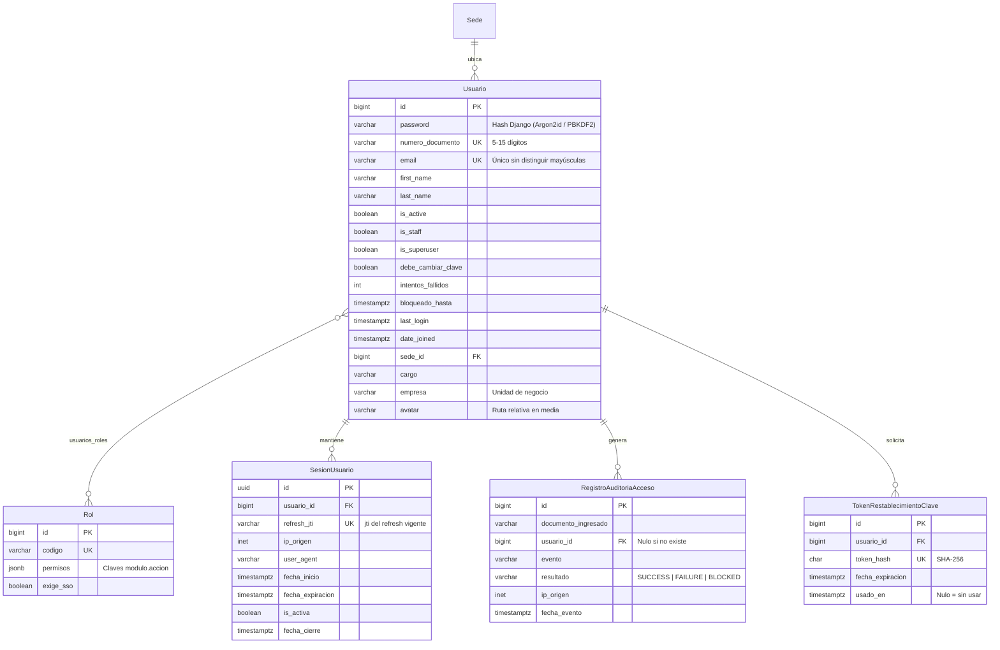

# Modelos de Datos del Login — SDD
## Directorio: `.sdd/model/login/`

Especificación de datos del inicio de sesión y la identidad en Joli Foods. Cualquier implementación (Django ORM u otro) DEBE respetar los mismos campos, tipos, restricciones e índices. El DDL de referencia es para PostgreSQL.

---

## 1. Índice

| Archivo | Entidad | Contenido |
| :--- | :--- | :--- |
| [`spec_model_usuario.md`](./spec_model_usuario.md) | `Usuario` | Identidad: documento, correo, hash de clave (Django), roles M2M, estado y bloqueo. |
| [`spec_model_sesion_auditoria.md`](./spec_model_sesion_auditoria.md) | `SesionUsuario`, `RegistroAuditoriaAcceso`, lista negra | Sesiones activas, bitácora de accesos solo-inserción y revocación de refresh tokens. |
| [`spec_model_restablecimiento.md`](./spec_model_restablecimiento.md) | `TokenRestablecimientoClave` | Tokens de un solo uso (hash SHA-256, 15 min). |
| [`esquema_sql_canonico.md`](./esquema_sql_canonico.md) | DDL | `CREATE TABLE`, índices, restricciones y permisos de la bitácora. |
| [`implementacion_django_orm.md`](./implementacion_django_orm.md) | Código ORM | `AbstractBaseUser` + `PermissionsMixin` + `BaseUserManager` y demás modelos. |

Roles y sedes: [`../roles/spec_model_roles_permisos.md`](../roles/spec_model_roles_permisos.md).

---

## 2. Diagrama Entidad-Relación

La lista negra de refresh tokens usa la app `rest_framework_simplejwt.token_blacklist` (no aparece en el diagrama).
