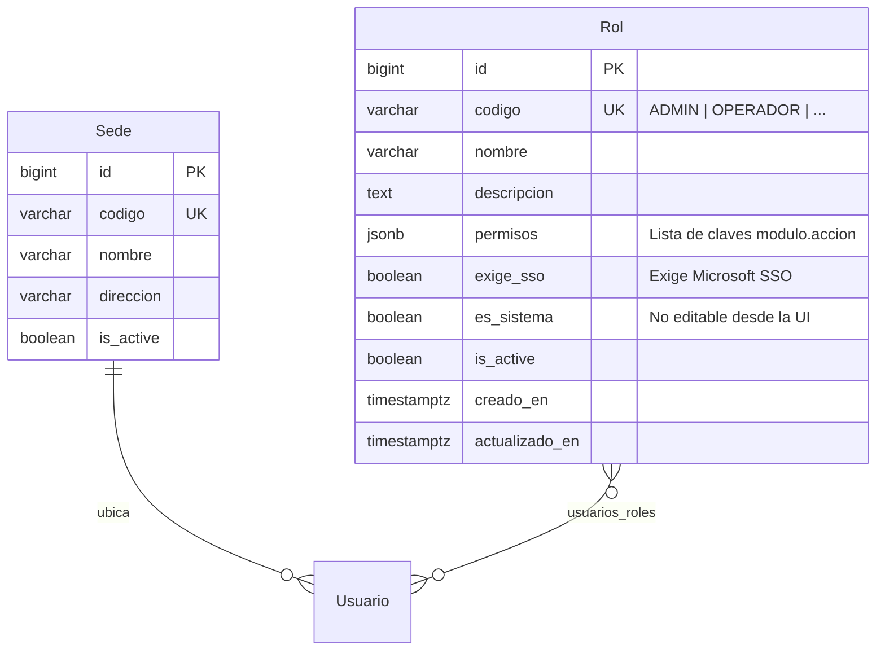

# Especificación de Modelo: Roles, Permisos y Sedes (RBAC)
## Directorio: `.sdd/model/roles/spec_model_roles_permisos.md`

Control de acceso basado en roles (RBAC, *Role-Based Access Control*) para las aplicaciones de Joli Foods, conforme a **BP-19** ([`../../greenfield/00_normativa_buenas_practicas_y_auditoria.md`](../../greenfield/00_normativa_buenas_practicas_y_auditoria.md)).

---

## 1. Principios

1. Los roles viven en **tabla propia** (`Rol`) y se asignan a usuarios por **muchos-a-muchos** (`Usuario.roles`). NO DEBE existir un campo de texto `rol`/`tipo` en el usuario. **Por qué:** permite crear o cambiar roles sin desplegar código y dar varios roles a una persona.
2. Cada rol guarda sus permisos como lista de **claves `modulo.accion`** en `permisos` (JSON). El backend y el frontend autorizan por clave de permiso, nunca por nombre de rol.
3. Los permisos efectivos de un usuario son la **unión** de los permisos de sus roles activos y se exponen en `GET /api/v1/mis-permisos/`.
4. Acciones estándar por módulo: `ver`, `crear`, `editar`, `eliminar`, `exportar`. El catálogo de módulos y acciones válidas se declara en código (`backend/config/permisos.py`) y el serializer DEBE rechazar claves que no estén en él.

### Roles de ejemplo (datos semilla, no código)

| Código | Nombre | Permisos de ejemplo | `exige_sso` | `es_sistema` |
| :--- | :--- | :--- | :--- | :--- |
| `ADMIN` | Administrador | todas las claves | `true` | `true` |
| `OPERADOR` | Operador de módulo | `dashboard.ver`, `inventario.ver`, `inventario.crear`, `inventario.editar` | `false` | `false` |
| `AUDITOR` | Auditor | `auditoria.ver`, `auditoria.exportar` | `false` | `false` |
| `CONSULTA` | Consulta | `dashboard.ver` | `false` | `false` |

Un rol con `es_sistema = true` no se puede eliminar ni editar desde la interfaz (evita dejar el sistema sin administradores).

---

## 2. Entidades



---

## 3. DDL (PostgreSQL)

```sql
CREATE TABLE organizacion_sede (
    id        BIGSERIAL    PRIMARY KEY,
    codigo    VARCHAR(30)  NOT NULL,
    nombre    VARCHAR(150) NOT NULL,
    direccion VARCHAR(255) NOT NULL DEFAULT '',
    is_active BOOLEAN      NOT NULL DEFAULT TRUE,
    CONSTRAINT uq_sede_codigo UNIQUE (codigo)
);

CREATE TABLE auth_rol (
    id             BIGSERIAL    PRIMARY KEY,
    codigo         VARCHAR(30)  NOT NULL,
    nombre         VARCHAR(100) NOT NULL,
    descripcion    TEXT         NOT NULL DEFAULT '',
    permisos       JSONB        NOT NULL DEFAULT '[]'::jsonb,
    exige_sso      BOOLEAN      NOT NULL DEFAULT FALSE,
    es_sistema     BOOLEAN      NOT NULL DEFAULT FALSE,
    is_active      BOOLEAN      NOT NULL DEFAULT TRUE,
    creado_en      TIMESTAMPTZ  NOT NULL DEFAULT CURRENT_TIMESTAMP,
    actualizado_en TIMESTAMPTZ  NOT NULL DEFAULT CURRENT_TIMESTAMP,
    CONSTRAINT uq_rol_codigo UNIQUE (codigo),
    CONSTRAINT chk_rol_permisos_array CHECK (jsonb_typeof(permisos) = 'array')
);
```

La tabla de relación `usuarios_roles` está en [`../login/esquema_sql_canonico.md`](../login/esquema_sql_canonico.md).

---

## 4. Django ORM (`backend/apps/organizacion/models.py`)

```python
from django.core.exceptions import ValidationError
from django.db import models


def validar_lista_permisos(valor):
    """Debe ser una lista de claves 'modulo.accion' declaradas en config/permisos.py."""
    from config.permisos import CLAVES_PERMISO  # conjunto de claves válidas

    if not isinstance(valor, list) or not all(isinstance(v, str) for v in valor):
        raise ValidationError("Los permisos deben ser una lista de textos.")
    invalidas = set(valor) - CLAVES_PERMISO
    if invalidas:
        raise ValidationError(f"Claves de permiso no reconocidas: {', '.join(sorted(invalidas))}")


class Rol(models.Model):
    codigo = models.CharField(max_length=30, unique=True)
    nombre = models.CharField(max_length=100)
    descripcion = models.TextField(blank=True, default="")
    permisos = models.JSONField(default=list, validators=[validar_lista_permisos])
    exige_sso = models.BooleanField(default=False)
    es_sistema = models.BooleanField(default=False)
    is_active = models.BooleanField(default=True)
    creado_en = models.DateTimeField(auto_now_add=True)
    actualizado_en = models.DateTimeField(auto_now=True)

    class Meta:
        db_table = "auth_rol"
        verbose_name = "rol"
        verbose_name_plural = "roles"
        ordering = ["nombre"]

    def __str__(self) -> str:
        return f"{self.nombre} ({self.codigo})"


class Sede(models.Model):
    codigo = models.CharField(max_length=30, unique=True)
    nombre = models.CharField(max_length=150)
    direccion = models.CharField(max_length=255, blank=True, default="")
    is_active = models.BooleanField(default=True)

    class Meta:
        db_table = "organizacion_sede"
        verbose_name = "sede"
        verbose_name_plural = "sedes"
        ordering = ["nombre"]

    def __str__(self) -> str:
        return self.nombre
```

La restricción `jsonb_typeof(permisos) = 'array'` del DDL se agrega en Django con una migración `RunSQL` (el ORM no la expresa directamente); la validación de contenido la hace `validar_lista_permisos`.

### Endpoint de permisos efectivos (sin N+1)

```python
# GET /api/v1/mis-permisos/
usuario = Usuario.objects.prefetch_related("roles").get(pk=request.user.pk)
return Response({"roles": [r.codigo for r in usuario.roles.all() if r.is_active],
                 "permisos": sorted(usuario.get_permisos())})
```

Todo cambio de permisos de un rol DEBE registrarse en la bitácora ([`../auditoria/spec_model_bitacora.md`](../auditoria/spec_model_bitacora.md)) con `payload_antes` y `payload_despues`.
