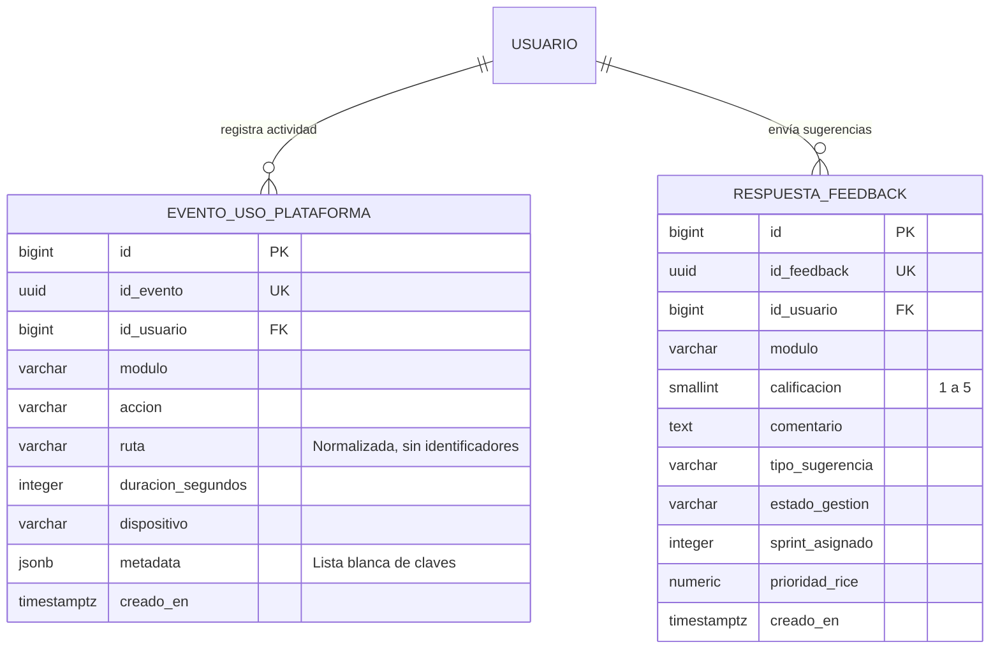

# Especificación de Modelos de Datos — Telemetría y Feedback In-App
## Joli Foods — Spec-Driven Development (SDD)
### Módulo: `telemetria` (Protocolo SDLC 12 y PlatformUsageDashboard)

Persistencia para medir la adopción de módulos y recibir micro-encuestas y sugerencias de los usuarios, como insumo para la mejora continua.

---

## 0. Minimización de Datos Personales (DEBE)

| Regla | Por qué |
| :--- | :--- |
| NO se guardan IP ni *user agent* completo; solo el tipo de dispositivo (`Desktop`, `Mobile`, `Tablet`, `Kiosk`). | Para medir adopción no se necesitan y son datos personales (Ley 1581 de 2012). |
| `ruta` se guarda **normalizada** (`/usuarios/:id`), sin identificadores, documentos ni parámetros de búsqueda. | Las URL suelen llevar datos personales. |
| `metadata` solo admite claves de una lista blanca (`kpi`, `formato_exportacion`, `vista`, `filtro_tipo`), nunca texto escrito por el usuario. | Evita que se cuele información sensible. |
| Retención de eventos: 13 meses (`TELEMETRIA_RETENCION_DIAS`); después se agregan por módulo y mes, y se borran. | Limita la exposición en el tiempo. |
| Los reportes de uso se publican agregados (por módulo, rol o sede), no por persona. | La telemetría no es una herramienta de vigilancia individual. |
| El comentario de feedback es texto libre: la interfaz DEBE advertir "No incluyas datos personales". | El usuario podría escribir datos propios o de terceros. |

---

## 1. Esquema



---

## 2. DDL (PostgreSQL)

```sql
-- 1. Eventos de uso
CREATE TABLE IF NOT EXISTS telemetria_evento_uso (
    id                BIGSERIAL    PRIMARY KEY,
    id_evento         UUID         NOT NULL DEFAULT gen_random_uuid() UNIQUE,
    id_usuario        BIGINT       NULL REFERENCES usuarios(id) ON DELETE SET NULL,
    modulo            VARCHAR(80)  NOT NULL,
    accion            VARCHAR(60)  NOT NULL DEFAULT 'NAVIGATE',
    ruta              VARCHAR(255) NOT NULL,
    duracion_segundos INTEGER      NOT NULL DEFAULT 0 CHECK (duracion_segundos >= 0),
    dispositivo       VARCHAR(10)  NULL CHECK (dispositivo IN ('Desktop', 'Mobile', 'Tablet', 'Kiosk')),
    metadata          JSONB        NOT NULL DEFAULT '{}'::jsonb,
    creado_en         TIMESTAMPTZ  NOT NULL DEFAULT CURRENT_TIMESTAMP
);

CREATE INDEX idx_telemetria_modulo_creado  ON telemetria_evento_uso (modulo, creado_en DESC);
CREATE INDEX idx_telemetria_usuario_creado ON telemetria_evento_uso (id_usuario, creado_en DESC);
CREATE INDEX idx_telemetria_creado_en      ON telemetria_evento_uso (creado_en DESC);

-- 2. Micro-encuestas y feedback
CREATE TABLE IF NOT EXISTS telemetria_feedback_usuario (
    id              BIGSERIAL    PRIMARY KEY,
    id_feedback     UUID         NOT NULL DEFAULT gen_random_uuid() UNIQUE,
    id_usuario      BIGINT       NULL REFERENCES usuarios(id) ON DELETE SET NULL,
    modulo          VARCHAR(80)  NOT NULL,
    calificacion    SMALLINT     NOT NULL CHECK (calificacion BETWEEN 1 AND 5),
    comentario      TEXT         NOT NULL DEFAULT '',
    tipo_sugerencia VARCHAR(40)  NOT NULL DEFAULT 'MEJORA'
                    CHECK (tipo_sugerencia IN ('MEJORA', 'BUG', 'NUEVA_FUNCION', 'USABILIDAD')),
    estado_gestion  VARCHAR(30)  NOT NULL DEFAULT 'PENDIENTE'
                    CHECK (estado_gestion IN ('PENDIENTE', 'EVALUADO', 'EN_SPRINT', 'RESUELTO', 'DESCARTADO')),
    sprint_asignado INTEGER      NULL CHECK (sprint_asignado IS NULL OR sprint_asignado >= 0),
    prioridad_rice  NUMERIC(8,2) NULL,
    creado_en       TIMESTAMPTZ  NOT NULL DEFAULT CURRENT_TIMESTAMP
);

CREATE INDEX idx_feedback_modulo_estado ON telemetria_feedback_usuario (modulo, estado_gestion);
CREATE INDEX idx_feedback_creado        ON telemetria_feedback_usuario (creado_en DESC);
CREATE INDEX idx_feedback_usuario       ON telemetria_feedback_usuario (id_usuario);
```

---

## 3. Django ORM (`backend/apps/telemetria/models.py`)

```python
import uuid

from django.conf import settings
from django.core.exceptions import ValidationError
from django.core.validators import MaxValueValidator, MinValueValidator
from django.db import models
from django.db.models import Q

CLAVES_METADATA_PERMITIDAS = {"kpi", "formato_exportacion", "vista", "filtro_tipo"}


def validar_metadata(valor):
    if not isinstance(valor, dict) or set(valor) - CLAVES_METADATA_PERMITIDAS:
        raise ValidationError("metadata solo admite claves de la lista blanca.")


class EventoUsoPlataforma(models.Model):
    """Eventos de navegación, clics en KPIs o exportaciones (sin IP ni user agent)."""

    class Dispositivo(models.TextChoices):
        DESKTOP = "Desktop"
        MOBILE = "Mobile"
        TABLET = "Tablet"
        KIOSK = "Kiosk"

    id_evento = models.UUIDField(default=uuid.uuid4, unique=True, editable=False)
    usuario = models.ForeignKey(
        settings.AUTH_USER_MODEL,
        on_delete=models.SET_NULL,
        null=True,
        blank=True,
        related_name="eventos_telemetria",
        db_column="id_usuario",
    )
    modulo = models.CharField(max_length=80)
    accion = models.CharField(max_length=60, default="NAVIGATE")
    ruta = models.CharField(max_length=255, help_text="Ruta normalizada, p. ej. /usuarios/:id")
    duracion_segundos = models.PositiveIntegerField(default=0)
    dispositivo = models.CharField(max_length=10, choices=Dispositivo.choices, null=True, blank=True)
    metadata = models.JSONField(default=dict, blank=True, validators=[validar_metadata])
    creado_en = models.DateTimeField(auto_now_add=True)

    class Meta:
        db_table = "telemetria_evento_uso"
        verbose_name = "evento de telemetría"
        verbose_name_plural = "eventos de telemetría"
        ordering = ["-creado_en"]
        indexes = [
            models.Index(fields=["modulo", "-creado_en"], name="idx_telemetria_modulo_creado"),
            models.Index(fields=["usuario", "-creado_en"], name="idx_telemetria_usuario_creado"),
            models.Index(fields=["-creado_en"], name="idx_telemetria_creado_en"),
        ]

    def __str__(self):
        return f"{self.modulo} - {self.accion} ({self.creado_en:%Y-%m-%d %H:%M})"


class RespuestaFeedback(models.Model):
    """Micro-encuestas in-app y solicitudes de mejora."""

    class TipoSugerencia(models.TextChoices):
        MEJORA = "MEJORA", "Mejora de proceso"
        BUG = "BUG", "Reporte de error"
        NUEVA_FUNCION = "NUEVA_FUNCION", "Nueva funcionalidad"
        USABILIDAD = "USABILIDAD", "Usabilidad"

    class EstadoGestion(models.TextChoices):
        PENDIENTE = "PENDIENTE", "Pendiente de revisión"
        EVALUADO = "EVALUADO", "Evaluado"
        EN_SPRINT = "EN_SPRINT", "En sprint"
        RESUELTO = "RESUELTO", "Implementado en producción"
        DESCARTADO = "DESCARTADO", "Descartado"

    id_feedback = models.UUIDField(default=uuid.uuid4, unique=True, editable=False)
    usuario = models.ForeignKey(
        settings.AUTH_USER_MODEL,
        on_delete=models.SET_NULL,
        null=True,
        blank=True,
        related_name="feedbacks_enviados",
        db_column="id_usuario",
    )
    modulo = models.CharField(max_length=80)
    calificacion = models.PositiveSmallIntegerField(
        validators=[MinValueValidator(1), MaxValueValidator(5)],
        help_text="Satisfacción del usuario (1 a 5)",
    )
    comentario = models.TextField(blank=True, default="")
    tipo_sugerencia = models.CharField(max_length=40, choices=TipoSugerencia.choices, default=TipoSugerencia.MEJORA)
    estado_gestion = models.CharField(max_length=30, choices=EstadoGestion.choices, default=EstadoGestion.PENDIENTE)
    sprint_asignado = models.PositiveIntegerField(null=True, blank=True)
    prioridad_rice = models.DecimalField(
        max_digits=8, decimal_places=2, null=True, blank=True, help_text="Puntaje según modelo RICE"
    )
    creado_en = models.DateTimeField(auto_now_add=True)

    class Meta:
        db_table = "telemetria_feedback_usuario"
        verbose_name = "feedback de usuario"
        verbose_name_plural = "feedback de usuarios"
        ordering = ["-creado_en"]
        indexes = [
            models.Index(fields=["modulo", "estado_gestion"], name="idx_feedback_modulo_estado"),
            models.Index(fields=["-creado_en"], name="idx_feedback_creado"),
        ]
        constraints = [
            models.CheckConstraint(condition=Q(calificacion__gte=1, calificacion__lte=5), name="chk_feedback_calificacion"),
        ]

    def __str__(self):
        return f"[{self.calificacion}/5] {self.modulo}: {self.tipo_sugerencia} ({self.estado_gestion})"
```

`db_column="id_usuario"` alinea el nombre de columna del ORM con el DDL (`id_usuario`); el índice de esa FK lo crea Django automáticamente.
